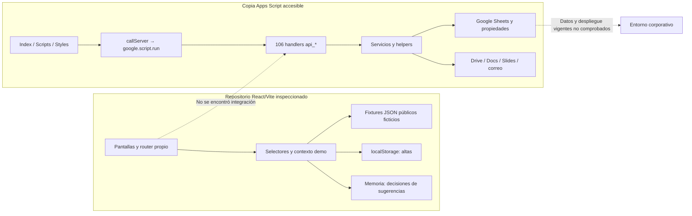
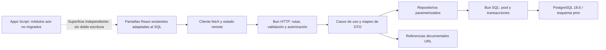

# Migración de Apps Script a Bun

> **Estado:** plan aprobado por el owner el 2026-10-26; T-01 ejecutado. Ninguna otra tarea está implementada.
> **Owner:** Pedro Lopez Chavarria.
> **Base verificada:** rama `dev-tvt-foundry`, HEAD `315bb91a3de59471e2dadb37824295d9c8666b83`, árbol limpio al iniciar la investigación.
> **Autoridades:** `AGENTS.md`, `src/design-system/DESIGN.md`, código y fixtures vigentes; este plan para el alcance del laboratorio conectado.
> **Límite:** este documento no certifica Foundry, no autoriza uso corporativo, carga histórica, cierre, retiro de Apps Script, commits, push ni despliegue.

La investigación original fue de solo lectura: no ejecutó instalaciones, pruebas, builds, SQL, commits ni cambios de archivos. T-01 agregó este documento y actualizó la documentación de alcance; nada del laboratorio está implementado.

## 1. Resumen ejecutivo

- Base acordada durante esta investigación: **`dev-tvt-foundry`**, sustituyendo la solicitud inicial de `dev`; no se cambió de rama.
- Arquitectura propuesta: frontend React/Vite existente → API HTTP nativa de Bun → casos de uso y repositorios SQL → PostgreSQL **18.6**.
- Conservar Node/pnpm para las herramientas del frontend; incorporar Bun como runtime del backend, sin convertir el proyecto innecesariamente en monorepo.
- Primera entrega vertical: **consulta de proyectos y catálogos desde PostgreSQL, visible en `/proyectos`**, con búsqueda, filtros, carga, errores y E2E.
- Según la aclaración del usuario, el modo conectado se adaptará al SQL y a la lógica Apps Script comprobada; retirará funciones de demo sin persistencia equivalente.
- Las escrituras iniciales se limitarán a un **laboratorio aislado con datos sintéticos**. El uso corporativo compartido queda bloqueado por identidad y autorización pendientes.
- Los principales riesgos son divergencias de identidad, escalas de riesgo, finanzas, repases, cierres y ausencia de auditoría previa verificable.
- Quedan excluidos salarios/tarifas, SSO integral, política de sobretiempo, IA real, proveedores de almacenamiento nuevos y carga histórica no autorizada.
- El retiro completo de Apps Script dependerá de resolver sus módulos sin equivalente en el frontend actual.
- Investigación realizada únicamente mediante lectura; no se ejecutaron instalaciones, pruebas, builds, SQL, commits ni cambios de archivos.

## 2. Inventario de evidencia

### 2.1. Convenciones y nivel de certeza

- **H — Hecho:** comprobado en archivos o mediante comandos de lectura.
- **I — Inferencia:** conclusión razonada, sin equivalencia funcional demostrada.
- **D — Decisión:** arquitectura o comportamiento elegido en este plan.
- **P — Pendiente:** requiere evidencia o decisión antes de implementar la parte afectada.

Las rutas propuestas como **NUEVA** no describen archivos encontrados. Son incorporaciones explícitas de este plan.

Abreviaturas para referencias:

| Código | Ubicación absoluta |
|---|---|
| **R** | `C:\Users\Pedro Lopevia\Escritorio\cusn-pm-risk-assesment` |
| **A** | `C:\Users\Pedro Lopevia\Downloads\pmo-appscript` |
| **S** | `C:\Users\Pedro Lopevia\Downloads\pmo_gestion_riesgos_esquema_logico_pg18.sql` |

Así, `R/src/App.tsx:17` significa el archivo y línea bajo la raíz absoluta **R**.

### 2.2. Git, topología y herramientas

| Aspecto | Evidencia y resultado |
|---|---|
| Repositorio | **H:** accesible en **R** mediante comandos elevados de lectura. |
| Rama activa | **H:** `dev-tvt-foundry`, siguiendo `origin/dev-tvt-foundry`. |
| HEAD | **H:** `315bb91a3de59471e2dadb37824295d9c8666b83`. |
| Estado local | **H:** `git status --porcelain=v1 --untracked-files=all` sin entradas; limpio también al terminar. |
| Rama inicialmente solicitada | **H:** `dev` existe; último commit observado `47f1919`. **D:** el usuario eligió usar `dev-tvt-foundry`. |
| Diferencias entre ramas | **H:** afectan normas, componentes, pantallas, configuración, contenedor, dependencias y pruebas. No son bases intercambiables. |
| Submódulos | **H:** `git submodule status` sin entradas y ausencia de `.gitmodules`. |
| Paquetes | **H:** un manifiesto raíz; no hay backend ni workspaces de aplicaciones declarados. `pnpm-workspace.yaml` contiene principalmente políticas. |
| Lockfile | **H:** `pnpm-lock.yaml`, formato `9.0`, importador raíz. No se encontró un lockfile Bun en el listado raíz. |
| CodeGraph | **H:** informó que el repositorio no está indexado. Se continuó con lectura directa; no se inicializó ni modificó el índice. |
| Herramientas en PATH | **H:** se localizaron Docker, Node y pnpm; no Bun ni `psql`. No se comprobó un servidor PostgreSQL local ni su versión. |
| Pruebas ejecutadas | Ninguna. La presencia de pruebas o dependencias instaladas no acredita resultados. |

El servidor filesystem disponible no autorizaba **R**; la inspección usó PowerShell/Git de solo lectura. No se accedió a otros repositorios.

### 2.3. Stack y reglas reales del frontend

Fuentes: [package.json](</C:/Users/Pedro Lopevia/Escritorio/cusn-pm-risk-assesment/package.json:6>), [AGENTS.md](</C:/Users/Pedro Lopevia/Escritorio/cusn-pm-risk-assesment/AGENTS.md:3>), [components.json](</C:/Users/Pedro Lopevia/Escritorio/cusn-pm-risk-assesment/components.json:2>).

| Elemento | Versión/configuración comprobada |
|---|---|
| Node / pnpm | `22.23.4` / `12.12.1`, exactos |
| React / React DOM | `19.3.0` |
| TypeScript | `7.0.2`; `strict`, `noUncheckedIndexedAccess`; configuración actual orientada al navegador |
| Vite | `8.3.4`; alias `@` hacia `src`; plugin React |
| Tailwind | `4.3.3`, plugin Vite |
| Primitivas | Radix Dialog `1.3.1`, Tabs `1.2.1` |
| Iconos / movimiento | Lucide `1.56.0`, Motion `14.2.0` |
| Pruebas | Vitest `5.0.5`, Testing Library, Playwright `1.64.1`, axe |
| ESLint | Dependencia `10.12.0`; no hay script `lint` en el manifiesto inspeccionado |
| Routing | Router propio con History API, `R/src/navigation.tsx:5–46` |
| Renderizado | SPA cliente; `components.json` declara `rsc:false`; no hay límites RSC/servidor |
| HTTP/backend actual | Ausentes en el frontend inspeccionado |

**Normas aplicables:**

1. `R/AGENTS.md:5–10` exige conservar el diseño, tokens, fuentes locales, wrappers y controles de seguridad/pruebas.
2. `R/src/design-system/DESIGN.md:322–348` define estados de formularios, tablas, carga, accesibilidad y colores semánticos.
3. Reutilizar `primitives.tsx`, `record-dialog.tsx`, indicadores y gráficos existentes.
4. `R/.agents/roles/delivery.md` prohíbe ejecutar generadores y actualizadores. No se encontró un generador obligatorio de componentes del producto.
5. La skill shadcn contiene ejemplos con CLI, pero **no prevalecen** sobre la prohibición local ni justifican ejecutar `pnpm dlx`.
6. `components.json` declara estilo `radix-vega`, TSX, variables CSS y aliases. Un alias declarado no demuestra que exista su archivo destino.
7. No se necesitan componentes visuales nuevos para el primer corte: se adaptarán datos, controles y estados de los existentes.
8. `.opencode/` está sellado: no editar, regenerar, sincronizar ni copiar archivos dentro.
9. `R/AGENTS.md:14–24` y `R/.agents/foundry/PROFILE.md:9–11` documentan un alcance histórico exclusivamente frontend. La solicitud actual autoriza **planificar** la ampliación; la implementación deberá actualizar esas declaraciones fuera del árbol sellado.
10. La política pnpm exige versiones exactas, revisión de procedencia/transitivas/scripts y lockfile. No sustituirla por `bun install`.

Se consultaron las skills locales de shadcn, cadena de suministro y el perfil Foundry, además de Context7 para documentación pública. No se ejecutaron sus comandos.

### 2.4. Frontend: pantallas, estado y puntos de sustitución

| Pantalla/superficie | Datos y comportamiento comprobados | Punto de sustitución |
|---|---|---|
| Login | Credenciales ficticias comprobadas en cliente; marcador en `sessionStorage` | `R/src/demo/access.tsx:15–24`; `R/src/pages/Login.tsx` |
| Shell | Cuatro módulos, rutas contextuales, usuario ficticio | `R/src/App.tsx:17–69` |
| Proyectos | Búsqueda, filtros, orden, cuatro vistas, alta manual | `R/src/pages/Projects.tsx:21–59`; `projectRows`, `filterProjects` |
| Alta de proyecto | Campos obligatorios/adicionales, validación síncrona y navegación tras guardar | `R/src/pages/ManualForms.tsx:14–40`; `R/src/demo/session.tsx:26–34` |
| Resumen de proyecto | Identidad, estado, seguimiento, riesgos, TCV/ACV y facturación | `R/src/pages/Project.tsx:15–42` |
| Ejecución | Serie histórica, SPI, hitos y tabla de avance | `R/src/pages/Project.tsx:44–54` |
| Registro de riesgos | Global/proyecto, filtros, orden y sugerencias separadas | `R/src/pages/Risks.tsx:8–31` |
| Alta de riesgo | Tipo, ámbitos, categoría, responsable, escala 1–5, respuesta y próxima revisión | `R/src/pages/ManualForms.tsx:42–62` |
| Detalle de riesgo | Datos actuales, revisiones, acciones, eventos y exposición | `R/src/pages/RiskDetail.tsx:10–30` |
| Revisión de sugerencia | Aprobar/descartar; autorización visual por gestor; decisiones en memoria | `R/src/pages/SuggestionReview.tsx:10–51`; `session.tsx:48–66` |
| Workspace | Riesgos, revisiones vencidas, sugerencias y cambios de planificación pendientes | `R/src/demo/view-models.ts:91–113`; `R/src/pages/Workspace.tsx:31–67` |
| Portafolio | Estado, avance, atención y revisiones vencidas | `R/src/pages/Portfolio.tsx:12–52` |
| Finanzas | Moneda/período, tres series con fechas propias, diferencia comparable y egresos demo | `R/src/pages/Finance.tsx:10–33`; `R/src/demo/finance.ts:7–34` |
| Diálogos/carga | Conservación del formulario, confirmación de descarte, foco; lazy loading de código | `R/src/components/organisms/record-dialog.tsx:6–22`; `route-loader.tsx:3–12` |

**H:** no se encontraron `google.script.run`, `fetch`, Axios ni XHR en el código de aplicación inspeccionado. No existe un cliente Apps Script que simplemente pueda cambiar de URL.

**H:** la fuente actual son JSON importados por `R/src/demo/data/index.ts:1–23`; los tipos se infieren de esos fixtures. Las altas se guardan en `gpl.demo.records.v1`, leyendo formatos 1/2 y escribiendo 2 (`records.ts:64–89`). Las decisiones de sugerencias son de sesión.

**H:** hay fixtures de usuarios, proyectos, estados, progreso, hitos, facturación, compras, horas, cambios, compromisos, riesgos y documentación. Su presencia no equivale a una pantalla editable. “Cambios” y “Gestión” están deshabilitados en `ProjectFrame.tsx:21`.

### 2.5. Apps Script y auditoría

Backend encontrado en **A**: **26 archivos `.gs`**, HTML/CSS y manifiesto llamado realmente **`appscript.json`**. `Config.gs:7` declara versión `v5.7.5`; no se verificó que corresponda al despliegue corporativo vigente.

- Entrada: `A/Code.gs:6–14`, `doGet`, plantilla `Index`.
- RPC: `A/Scripts.html:153–165`, `callServer(fn,...args)` sobre `google.script.run`.
- Respuestas: `A/Helpers.gs:310–318`, `{ok:true,data}` o `{ok:false,message}`.
- Persistencia: `A/Helpers.gs:5–25`, SpreadsheetApp y propiedades del script.
- El arranque puede crear/ajustar hojas: `ensureMasterSetup_`, `Helpers.gs:93–107`. No ejecutar durante la investigación ni portar esa conducta a GET.
- Concurrencia: `withLock_`, `Helpers.gs:337–349`; no es una transacción SQL.
- Identidad: Session y listas de editor/admin/aprobador, `Helpers.gs:630–684`. El aprobador no se hereda automáticamente de admin.
- Manifiesto: ejecución como desplegador, acceso `DOMAIN`, zona `America/Santiago`, scopes de Sheets, Drive, Docs, Slides, correo y otros (`appscript.json:2–19`).
- No se comprobó el despliegue, usuarios efectivos, propiedades, permisos ni datos remotos.

**Inventario de familias RPC:** se localizaron **106 funciones `api_*`** en `Api.gs`. No se afirma auditoría semántica exhaustiva de las 106.

| Familia | Handlers/servicios inspeccionados | Entradas, efectos y límites relevantes |
|---|---|---|
| Configuración/proyectos | `api_bootstrap`, `api_listProjects`, `api_getWorkspace`, `api_getProjectByTVT`, `api_saveProject`; `Api.gs:5–119` | Filtros/TVT/payload; lecturas y upsert; snapshot posterior best-effort |
| Estado/facturación | `api_saveStatus/Info/Fact/EstadoProyecto`, historial; `Api.gs:121–168,500–524` | Secciones del proyecto, escritura current/log/facturación; lock, sin rollback real |
| Riesgos | `api_loadRiesgos`, `api_getRiskById`, `api_saveRisk`, transversales; `Api.gs:170–201,1967` | Global sin proyecto o proyecto; categoría/estrategia/responsable; escala 1–4 |
| Cambios | `api_loadCambios`, `api_saveCambio`, exportación; `Api.gs:204–249` | Solicitudes, ámbitos, responsables, costo/moneda; exportación Docs separada |
| Planificación | `Api.gs:2003–2070`; `CambiosPlanService.gs` | Referencias a CC, excepciones justificadas, pendientes y aprobaciones; notificaciones |
| Repases | `Api.gs:251–290`; `RepasesService.gs` | Asignación por proyecto/mes/área; consumo actual derivado de horas |
| Compras | `Api.gs:332–385`; `ComprasService.gs:109–192` | Proyecto válido, etapas, importes, recepción; estado calculado por etapa |
| Horas/especialistas | `Api.gs:1366–1415,1976–1999`; `HorasService.gs` | Registro múltiple, edición/eliminación con autoría, consultas y agregados |
| Complejidad | `Api.gs:662–695`; `ComplejidadService.gs:15–118` | Cuatro factores, pesos, redondeo y override estratégico |
| Lecciones/compromisos | `Api.gs:67–69,1936–1959`; servicios homónimos | Persistencia verificada por funciones; sin pantalla equivalente actual completa |
| Dashboard/snapshot | `Api.gs:302–327`; `SnapshotService.gs` | Datos derivados y cachés; no deben convertirse automáticamente en tablas duplicadas |
| Documentos/presentaciones/reportes | `DocsService.gs:74–80`, `SlidesService.gs:951–978`, handlers de exportación | Creación de archivos en Google; no equivalentes a consultas SQL |
| Correo/triggers | `ReminderService.gs:177,281,381`; `Api.gs:628–645` | Envíos y programación; fuera de esta implementación |
| Mantenimiento/destrucción | `Api.gs:389,650–711,1302–1318,2044–2061` | Cachés, reparaciones y borrados: no exponer automáticamente en Bun |

**Auditoría previa:** no se identificó un informe del agente anterior entre los materiales inspeccionados. Los dos DOCX locales son propuestas de requisitos/IA; no acreditan esa auditoría. Sus menciones de auditoría no demuestran una evaluación del backend.

**Materiales faltantes:** los 20 CSV originales, manifiesto/versionado del despliegue Apps Script activo y auditoría previa. Los comentarios del SQL sobre anomalías históricas se tratarán como antecedentes del modelo, no como estadísticas revalidadas en esta sesión.

### 2.6. SQL: identidad y alcance de la inspección

Se leyeron las **488 líneas** del SQL. Ambos archivos existen y son idénticos:

- [SQL mencionado inicialmente](</C:/Users/Pedro Lopevia/Downloads/pmo_gestion_riesgos_esquema_logico.sql>)
- [SQL pg18](</C:/Users/Pedro Lopevia/Downloads/pmo_gestion_riesgos_esquema_logico_pg18.sql>)

SHA-256 común:

`4308A7ECBABD9A7000F3A5D13B593F1C67A95594D239D0DD87BF580564748FE8`

**H:** un esquema `pmo`, **24 tablas**, `BEGIN/COMMIT`, `search_path pmo, public`; sin extensiones, triggers, funciones, roles ni grants.

**D, tras aclaración del usuario:** usar este modelo como autoridad estructural del modo conectado. No significa afirmar que ejecuta correctamente ni autorizar carga histórica o cambios silenciosos del DDL.

#### Inventario de columnas y restricciones

En lo siguiente, todas las tablas tienen PK `id bigint GENERATED ALWAYS AS IDENTITY`, salvo las PK indicadas expresamente. Las referencias son a **S**.

| Tabla / líneas | Columnas, claves y restricciones relevantes |
|---|---|
| `catalogo_valor`, 16–24 | `id,tipo,valor,padre_valor,orden,activo`; tipo/valor obligatorios y no vacíos; `UNIQUE(tipo,valor)`; activo=true. Padre es texto, sin FK. |
| `unidad_monetaria`, 27–38 | PK `codigo varchar(3)`; `clase` obligatoria; CHECK de clase y nueve códigos. Seed incluido con `ON CONFLICT DO NOTHING`. |
| `cliente`, 42–47 | `id,nombre,sector_industria,descripcion`; nombre obligatorio/no vacío, sin unicidad por nombre. |
| `proveedor`, 49–52 | `id,nombre`; nombre obligatorio/no vacío, sin unicidad por nombre. |
| `proyecto`, 55–89 | `id,tvt,tvt_key_origen,nombre,cliente_id,estado_cliente,pais,lob,servicio_lob,squad,gestor_nombre,preventa,tam,sdm,account_manager,sap,ceco,pep,tcv,tcv_unidad_codigo,fecha_recepcion_p1p2,fecha_termino_baseline,contraparte_cliente,correo_cliente,telefono_cliente,situacion_inicial,lideres_tecnicos,activo,ultimo_recordatorio_at,creado_at,actualizado_at,creado_por,actualizado_por`. TVT obligatorio/no vacío/único; key de origen única nullable; nombre obligatorio; FKs opcionales cliente/unidad; activo=true. |
| `especialista`, 93–107 | `id,nombre,email_corporativo,cargo,lob,pais`; nombre obligatorio; CHECK de email nullable `@tivit.com`; índice único parcial sobre `lower(email_corporativo)`. |
| `estado_proyecto`, 110–117 | `id,nombre,es_cierre,requiere_documentacion`; nombre obligatorio/no vacío/único; flags=false; CHECK documentación implica cierre, no la implicación inversa. |
| `proyecto_estado_actual`, 119–145 | PK/FK `proyecto_id`; FK obligatoria `estado_proyecto_id`; `fecha_registro_avance,avance_planificado_pct,avance_real_pct,spi_pct,fecha_inicio_proyecto,fecha_termino_proyecto,plazo_meses,operacion_no_aplica,meses_servicio,fecha_inicio_operacion,fecha_termino_operacion,margen_pct,estado_facturacion,facturacion_unidad_codigo,actividades,proximos_pasos,lecciones_resumen,checklist_entregables,terminado_fecha,terminado_mes,termino_real_base,actualizado_at,actualizado_por`. Unidad opcional; checklist JSONB. |
| `documento_proyecto`, 150–160 | `id,proyecto_id,tipo_documento,url,relacionado_con_cierre,validado,validado_at,validado_por,registrado_at`; proyecto/tipo/URL obligatorios; URL no vacía; cierre=false; registrado=now(). No comprueba esquema URL ni existencia remota. |
| `proyecto_evento`, 164–173 | `id,proyecto_id,tvt_key_origen,tvt_origen,registrado_at,tipo_evento,contenido,usuario_email`; proyecto nullable; fecha/tipo/JSONB obligatorios. |
| `proyecto_complejidad`, 176–192 | PK/FK `proyecto_id`; `factor_riesgo,factor_facturacion,factor_plazo,factor_alcance,nota_riesgo,nota_facturacion,nota_plazo,nota_alcance,indice_complejidad,tipificacion,override_estrategico,nota_override,actualizado_at,actualizado_por`; factores son texto, sin CHECK de escala. |
| `riesgo_global`, 197–216 | `id,risk_id_origen,nombre,causa_potencial,control_actual,estado,categoria,probabilidad,impacto,severidad,estrategia,plan_mitigacion,plan_contingencia,responsable_nombre,creado_at,actualizado_at,creado_por,actualizado_por`; origen único nullable; nombre obligatorio; sin CHECK de escala. |
| `riesgo_proyecto`, 218–240 | Las columnas funcionales/auditoría anteriores más `proyecto_id,riesgo_global_id,transversal`; proyecto obligatorio; global opcional; transversal=false; origen único nullable. |
| `solicitud_cambio`, 243–274 | `id,id_origen,proyecto_id,folio,secuencia,fecha_elaboracion,descripcion,justificacion,firmado,urgencia,responsable_cambio,responsable_cliente_nombre,responsable_cliente_correo,responsable_tivit_nombre,responsable_cuenta,costo,costo_unidad_codigo,costo_tipo,costo_fecha_facturacion,documento_url,documento_id_origen,documento_creado_at,aprobacion,creado_at,actualizado_at,creado_por,actualizado_por`; proyecto obligatorio; origen/folio únicos nullable; unidad opcional; `UNIQUE(id,proyecto_id)`. |
| `solicitud_cambio_ambito`, 277–282 | PK `(solicitud_cambio_id,posicion)`; FK solicitud obligatoria; posición 1–4; ámbito obligatorio/no vacío. |
| `cambio_planificacion`, 286–307 | `id,id_origen,proyecto_id,solicitud_cambio_id,cambio_ref_origen,cambio_folio_origen,cambio_documento_url,campo,valor_anterior,valor_propuesto,solicitante,estado,motivo,comentario,creado_at,resuelto_at,resuelto_por`; origen único; proyecto/campo obligatorios; FK compuesta solicitud+proyecto; enlace opcional. |
| `facturacion`, 311–329 | `id,id_origen,proyecto_id,periodo_mes,tipo,cuota,unidad_codigo,showprice,importe_planificado,importe_real,margen,estado,origen,origen_ref,comentario,actualizado_at,actualizado_por`; proyecto/período obligatorios; período día 1; origen único; unidad opcional. Sin unicidad proyecto/mes/tipo/cuota. |
| `compra`, 333–374 | `id,id_origen,proyecto_id,proveedor_id,proveedor_nombre_origen,fecha_compra,gestor_compra,clasificacion_capex_opex,estado_compra,concepto,estatus_solped,estatus_oc,aprobador_pendiente,aprobador_final,borp,solped,orden_compra,conformidad,descripcion,observaciones,fecha_borp,fecha_solped,fecha_orden_compra,fecha_conformidad,unidad_codigo,valor_setup,valor_recurrente,meses_recurrente,total,presupuesto,monto_adjudicado,ahorro,recepcion_esperada,recepcion_real,creado_at,actualizado_at,creado_por,actualizado_por`; proyecto obligatorio; proveedor/unidad opcionales; origen único; meses recurrentes nulo o ≥0. |
| `repase_asignacion`, 378–392 | `id,key_origen,proyecto_id,periodo_mes,area,horas_asignadas,descripcion,observacion,creado_at,actualizado_at,creado_por,actualizado_por`; proyecto/período/área/horas obligatorios; key única nullable; día 1; horas ≥0; `UNIQUE(id,proyecto_id)`. Sin unicidad de la terna de negocio. |
| `repase_consumo`, 397–415 | `id,id_origen,proyecto_id,asignacion_id,periodo_mes,fecha,area,recurso_nombre,horas_usadas,observacion,creado_at,actualizado_at,creado_por,actualizado_por`; origen único; proyecto/período/área/horas obligatorios; día 1; horas ≥0; FK compuesta asignación+proyecto opcional. |
| `registro_horas`, 420–439 | `id,id_origen,proyecto_id,especialista_id,especialista_nombre_origen,especialista_lob_origen,especialista_pais_origen,fecha,horas,tipo,modalidad_repase,comentario,email_formulario_origen,registrado_at`; proyecto/fecha/horas obligatorios; horas >0; especialista opcional; exige especialista o nombre de origen no vacío. Sin tope mensual ni unicidad diaria. |
| `compromiso`, 442–454 | `id,id_origen,titulo,descripcion,responsable,pais,completado,creado_at,actualizado_at,creado_por,actualizado_por`; origen único; sin vínculo a proyecto. |
| `leccion_aprendida`, 457–473 | `id,id_origen,proyecto_id,area,fecha,titulo,situacion,impacto,acciones_correctivas,leccion,correo_texto,creado_at,actualizado_at,creado_por,actualizado_por`; origen único; proyecto/título obligatorios. |
| `refresh_ejecucion`, 477–486 | `id,iniciado_at,finalizado_at,duracion_segundos,filas_snapshot,filas_fact,estado,error_detalle`; inicio obligatorio; bitácora técnica. |

**Tipos y dependencias comunes:**

- Importes: principalmente `numeric(20,4)`; horas `numeric(12,2)`; porcentajes/índices y severidades con las precisiones declaradas.
- Fechas civiles: `date`; auditoría/instantes: `timestamptz`; contenido de eventos/checklist: `jsonb`.
- No hay UUID de PK ni enums PostgreSQL.
- No hay cláusulas explícitas `ON DELETE`, cascadas ni FKs diferibles: no diseñar borrado en cascada. El comportamiento predeterminado de FK es `NO ACTION`. [Restricciones PostgreSQL 18](https://www.postgresql.org/docs/18/ddl-constraints.html).
- Las columnas temporales mayormente no tienen default ni trigger: el backend deberá asignarlas explícitamente.
- El DDL no valida automáticamente todos los dominios, rangos, relaciones de catálogos ni reglas de cierre.

**Revisión estática:** el orden de creación permite las referencias observadas y no se identificó un error sintáctico evidente. **No se ejecutó el DDL**, por lo que su validez efectiva sigue pendiente de PostgreSQL 18.6 aislado.

## 3. Arquitectura AS-IS



El RPC legacy y el frontend React son dos superficies distintas. No introducir un proxy de compatibilidad para `google.script.run` en React.

## 4. Arquitectura TO-BE



La línea de coexistencia representa una transición operativa documentada, **no** comunicación automática entre React y Apps Script.

**D:** incorporar un backend pequeño fuera de `src`, porque el `tsconfig` y build actuales tratan `src` como aplicación de navegador. Separar:

- HTTP: interpretar petición, autenticar/autorizar, validar y serializar.
- Aplicación: reglas, transacciones y coordinación.
- Repositorios: consultas, persistencia y traducción de errores.
- Adaptador SQL: conexión, pool y ciclo de vida.
- Frontend: fetch, estados remotos y presentación.

No incluir Sheets, Drive ni correo en repositorios SQL. En cierre, almacenar únicamente referencias URL cuando se habilite ese flujo; no descargar ni verificar archivos remotos automáticamente.

## 5. Matriz de trazabilidad

Todos los endpoints son **propuestas nuevas**, no APIs existentes. Namespace decidido: `/api/v1`.

Prioridades: **P0** primera entrega; **P1** consolidación del frontend conectado; **P2** condicionado o posterior.

| Funcionalidad/pantalla | Apps Script o ausencia | Endpoint propuesto | Caso de uso | Tablas SQL | Archivos frontend | Prioridad | Evidencia |
|---|---|---|---|---|---|---|---|
| Login conectado de laboratorio | Login React ficticio; Session Google no portable | `POST/GET/DELETE /sesion` | Iniciar/consultar/cerrar sesión local | Ninguna tabla nueva; sesión efímera | `access.tsx`, `Login.tsx`, `App.tsx` | P0 | H de ausencia; D de laboratorio |
| Catálogos de formularios | `ProjectsService_getConfig_internal_`; `CatalogosService_getAll` | `GET /catalogos` | Consultar dominios activos | `catalogo_valor`, `estado_proyecto`, `unidad_monetaria`, `cliente` | `catalogs.ts`, `ManualForms.tsx`, `Projects.tsx` | P0 | H |
| Lista/búsqueda de proyectos | `api_listProjects`; `TrackingService_listProjects` | `GET /proyectos` | Listar proyectos enriquecidos | `proyecto`, `cliente`, estado actual/estado, `riesgo_proyecto` | `Projects.tsx`, `view-models.ts` | P0 | H; ajuste DTO |
| Resumen | `api_getProjectByTVT`, `api_getWorkspace` | `GET /proyectos/:id` | Consultar identidad/estado actual | Proyecto, cliente, estado, complejidad | `App.tsx`, `Project.tsx`, `ProjectFrame.tsx`, `project-context.ts` | P0/P1 | H; retirar datos sin destino |
| Alta de proyecto | `api_saveProject`, formulario React | `POST /proyectos` | Crear proyecto y estado inicial | `proyecto`, `proyecto_estado_actual`, `proyecto_evento` | `ManualForms.tsx`, `session.tsx`, `records.ts` | P1 | H; solo laboratorio |
| Ejecución/historial | `api_getStatusHistory`; `EstadoService` | `GET /proyectos/:id/historial` | Consultar eventos de avance | `proyecto_evento`, estado actual | `Project.tsx`, `project-context.ts` | P1 | H; JSON histórico por validar |
| Complejidad mostrada | `api_getComplejidad` | Incluida en detalle de proyecto | Consultar evaluación existente | `proyecto_complejidad` | `Project.tsx`, `ManualForms.tsx` | P1 | H; sin nuevo editor |
| Registro global/de proyecto | `api_listAllRiesgos`, `api_loadRiesgos`, `api_listRiesgosTransversales` | `GET /riesgos`; `GET /proyectos/:id/riesgos` | Consultar riesgos por alcance | `riesgo_global`, `riesgo_proyecto`, proyecto | `Risks.tsx`, `view-models.ts` | P1 | H; modelo separado |
| Detalle global | `api_getRiskById` | `GET /riesgos/globales/:id` | Consultar riesgo global | `riesgo_global` | `RiskDetail.tsx`, `project-context.ts` | P1 | H; retirar revisiones/acciones |
| Detalle por proyecto | `api_getRiskById` | `GET /proyectos/:id/riesgos/:riskId` | Consultar aplicación particular | `riesgo_proyecto`, global opcional | Mismos anteriores | P1 | H + regla confirmada |
| Alta manual global/proyecto | `api_saveRisk`, formulario React | `POST /riesgos/globales`; `POST /proyectos/:id/riesgos` | Registrar definición o aplicación | Tablas de riesgos respectivas | `ManualForms.tsx`, `session.tsx` | P1 | H; escala 1–4 |
| Workspace | React `workItems`; `api_listCambiosPlanPendientes` | `GET /cambios-planificacion?estado=Pendiente` + lecturas de riesgos | Consultar pendientes existentes | `cambio_planificacion`, riesgos | `Workspace.tsx`, `view-models.ts` | P1 | H; sin equivalencia con workspace legacy |
| Portafolio | React; `api_getDashboardData` como antecedente | Reutilizar `GET /proyectos` y `/riesgos` | Agregar estado/avance/riesgos | Tablas ya consultadas | `Portfolio.tsx` | P1 | H; sin endpoint redundante |
| Finanzas | `api_getFacturacionGeneral` | `GET /facturacion` | Consultar/agregar por mes y unidad | `facturacion`, proyecto | `Finance.tsx`, `finance.ts`, `Project.tsx` | P1 | H; semántica ajustada al DDL |
| Compras en finanzas | `api_loadCompras`, `api_listAllCompras` | `GET /compras` | Consultar importes/etapas documentados | `compra`, proveedor, proyecto | `Finance.tsx`, `finance.ts` | P1 | H; sin inventar egresos reales |
| Sugerencias/revisión IA | Sin equivalente verificado ni tabla | **Ninguno** | Retirar del modo conectado | Ninguna | `SuggestionReview.tsx`, `ProjectFrame.tsx`, `Risks.tsx`, `Workspace.tsx` | P1 | D expresa del usuario |
| Hitos de ejecución | Fixtures; sin tabla equivalente | **Ninguno** | Retirar del modo conectado | Ninguna | `Project.tsx`, `project-context.ts` | P1 | D expresa |
| Revisiones/acciones/eventos de riesgo | Fixtures; DDL no los modela | **Ninguno** | Retirar del modo conectado | No usar `proyecto_evento` como sustituto ficticio | `RiskDetail.tsx`, modelos | P1 | D expresa |
| Horas/especialistas | Handlers HH verificados | **Por confirmar en entrega posterior** | Mantener legacy temporalmente | `registro_horas`, `especialista` | Sin pantalla React equivalente | P2 | H; sin UI actual |
| Asignación/uso de repases | `RepasesService` y `HorasService_usoRepasesDetalle` | **Por confirmar** | Mantener legacy; consumo derivado HH | Asignaciones, horas; consumo histórico separado | Sin pantalla React equivalente | P2 | H |
| Cambios formales/aprobaciones | `CambiosService`, `CambiosPlanService` | Solo consulta de pendientes en esta entrega | Mantener edición/aprobación legacy | Solicitud, ámbitos, planificación, estado/evento | Pestaña Cambios deshabilitada | P2 | H |
| Cierre/documentos | `EstadoService_saveStatus_internal_`; vía rápida divergente | **Sin endpoint de escritura hasta resolver reglas** | Bloqueo de cierre | Estado, documento, evento, riesgos | Sin formulario React actual | P2 | H + P documental |
| Mantenedores/lecciones/compromisos | Servicios existentes | **Sin endpoints nuevos ahora** | Mantener superficie legacy | Catálogos, lecciones, compromiso | Sin pantalla equivalente completa | P2 | H |
| Exportaciones/correo/Slides | APIs Google verificadas | **Ninguno** | Mantener o excluir explícitamente | Referencias, no sustitución del servicio Google | Sin equivalente React | P2 | H |

Los nombres frontend de esta tabla se interpretan bajo `R/src/screens` o `R/src/demo`, según el inventario anterior.

## 6. Matriz de discrepancias

| Diferencia | Clasificación | Resolución del plan |
|---|---|---|
| Solicitud inicial `dev` frente a rama activa | Resuelta | Usuario eligió `dev-tvt-foundry`; volver a verificar antes de implementar. |
| Foundry documentado solo para frontend | Ajuste documental | Actualizar alcance/perfil fuera del árbol sellado cuando se autorice implementar. No afirmar certificación backend. |
| React no consume Apps Script | Ajuste de arquitectura | Crear fuente remota y cliente HTTP; no un reemplazo ficticio de URL. |
| SQL preliminar frente a fixtures más amplios | Resuelta por usuario | SQL gobierna estructura; retirar del modo conectado capacidades sin destino. No añadir tablas para conservar la demo. |
| `ProjectDraft.id` mezcla identidad y código; SQL usa bigint + TVT + key | Ajuste de contrato | Separar `id`, `tvt`, `tvtKeyOrigen`; no convertir TVT en PK ni generar key histórica por heurística. |
| Normalización Apps Script extrae solo dígitos | Bloqueo de equivalencia histórica | No usar `normalizeTVT_` para transformar códigos alfanuméricos; conservar correspondencias originales. |
| Borrado/deshabilitación implementados en copia legacy | Divergencia con regla confirmada | No portar endpoints destructivos. La existencia de código no acredita uso funcional ni modifica la exclusión del usuario. |
| Gestores/responsables como IDs de usuario en demo, texto/catálogos en SQL | Ajuste de contrato | Usar valores de catálogo y nombres almacenados; no crear tabla de usuarios ni asociarlos a especialistas. |
| “Mis proyectos” depende de usuario ficticio | Bloqueo para uso corporativo | No mostrar esa vista en modo conectado hasta disponer de identidad y correspondencia verificable con gestor. |
| Riesgos: escala 1–5 UI, 1–4 Apps Script, SQL sin CHECK | Ajuste decidido | Nuevas entradas conectadas 1–4; sin reescalar históricos ni recortar valores anómalos. |
| Tipo amenaza/oportunidad y ámbitos múltiples sin columnas | Ajuste decidido | Retirar esos controles/etiquetas; categoría no equivale automáticamente a tipo o ámbitos. |
| Revisiones, acciones, sugerencias e hitos sin tablas | Ajuste decidido | Retirarlos del modo conectado, incluidos contadores derivados. |
| `description` demo y `situacion_inicial` SQL | Ajuste de semántica | Mostrar/editar “Situación inicial”; no afirmar equivalencia con descripción contractual. |
| Complejidad elegida libremente al crear frente a evaluación ponderada legacy | Ajuste | No guardar una selección libre como evaluación; alta sin evaluación y lectura posterior de tipificación existente. |
| Finanzas demo: tres fechas/fuentes y factura explícita; SQL: un mes | Ajuste decidido | Mostrar referencias por `periodo_mes`; retirar fechas independientes y acreditación de factura que el DDL no soporta. |
| Compras demo: egreso esperado/real; SQL: total/adjudicado/recepción | Ajuste decidido | Mostrar magnitudes con sus nombres SQL; recepción no implica fecha de pago ni adjudicado equivale a egreso real. |
| ACV demo almacenado; Apps Script lo calcula desde plan anual | Ajuste | Derivar por año y unidad desde facturación planificada; no añadir columna ni mezclar monedas. |
| `TCV` legacy admite “Ilimitado”; SQL solo numeric | Bloqueo de carga histórica | No convertir “Ilimitado” a 0/null sin decisión; registrar rechazo de conciliación. Alta conectada acepta decimal o ausencia. |
| Catálogo `UNIQUE(tipo,valor)` no incluye padre | Riesgo de conciliación | No agregar unicidad distinta ni fusionar servicios de LOB diferentes. Bloquear los registros conflictivos. |
| Flags de cierre SQL no obligan documentación en todo cierre | Bloqueo de escritura de cierre | La aplicación no puede considerar suficiente ese CHECK. Falta política documental mínima aprobada. |
| Cierre normal exige lecciones/checklist/riesgos; vía rápida no aplica lo mismo | Bloqueo de paridad de cierre | Unificar en un único caso de uso antes de habilitarlo; no portar el bypass. |
| Lock legacy comentado como “atómico” | Ajuste técnico | Implementar transacciones reales cuando se porten escrituras múltiples. |
| Repase consumo SQL frente a origen actual derivado de HH | Ajuste decidido | No sumar ambos; `repase_consumo` queda histórico, sin escritura automática. |
| Upsert legacy por proyecto/mes/área frente a SQL sin unicidad de terna | Bloqueo del mantenedor futuro | No inventar UNIQUE. La política de múltiples asignaciones requiere decisión antes de portar escritura. |
| Identificación por correo en `HorasService_usuario` | Riesgo histórico | No prueba que cada email de formulario pertenezca al especialista; no reasignar históricos. |
| Estados, monedas y FX legacy con defaults incompatibles | Ajuste | Catálogos aprobados; nueve unidades; sin EUR, `PAB(USD)` ni conversiones aproximadas. |
| Frontend fracciones; Apps Script/SQL porcentajes | Ajuste | Adaptador explícito entre porcentaje 0–100 y fracción UI; SPI como razón, con plan cero → ausencia comparable. |
| Compromisos demo enlazados a proyecto; SQL sin FK | Deuda futura | No fabricar vínculo. Mantener módulo fuera del frontend conectado inicial. |
| Auditoría, CSV y despliegue actual no disponibles | Bloqueo de paridad histórica | No afirmar migración integral ni conciliación de datos. |

## 7. Decisiones técnicas — ADR breves

### ADR-01 — HTTP nativo Bun, frontend conservado

**D:** `Bun.serve` y APIs estándar `Request/Response`; sin Express/Hono/Elysia inicialmente. La superficie es una API JSON pequeña, no existe un framework backend que conservar y no se necesitan SSR, WebSockets ni generación de interfaz.

Bun documenta routing y manejo de errores; su selección no reemplaza validación, autorización ni límites de entrada. [Routing](https://bun.com/docs/runtime/http/routing), [errores HTTP](https://bun.com/docs/runtime/http/error-handling).

**Alternativas:** un framework HTTP facilitaría plugins/esquemas, pero añadirlo ahora no responde a una dependencia observada. Reconsiderar únicamente ante una necesidad concreta registrada.

**Versionado:** Bun `1.4.4` es candidato exacto verificado en documentación oficial, publicado el 22 de octubre de 2026; todavía no está instalado ni probado aquí. Verificar binario, procedencia y compatibilidad antes de fijarlo. [Publicación oficial](https://bun.com/blog/bun-v1.4.4).

### ADR-02 — Bun SQL y SQL explícito, sin ORM

**D:** adaptador nativo `SQL` de Bun detrás de repositorios. La documentación acredita PostgreSQL, pool, consultas parametrizadas, transacciones y opciones TLS. `numeric` se recibe como string; normalizar siempre IDs a string y fechas mediante mapeo explícito. [Bun SQL](https://bun.com/docs/runtime/sql).

**Alternativa pertinente:** `pg`/node-postgres ofrece pool y control de parsers, pero no está instalado y su documentación consultada no certifica la combinación concreta Bun + PostgreSQL 18.6. Añadiría dependencias sin una necesidad actual. [Pool](https://node-postgres.com/apis/pool), [consultas](https://node-postgres.com/features/queries).

**Condición:** no afirmar compatibilidad certificada con 18.6 hasta pasar T-03. Si falla, detener esa entrega y reevaluar el adaptador con la misma batería; no cambiarlo silenciosamente.

### ADR-03 — Organización y dependencias

**D:** conservar el paquete raíz, pnpm y lockfile. No migrar Vite/Vitest/Playwright a Bun.

Incorporaciones **NUEVAS propuestas**:

- `server/`: entrada HTTP, configuración, casos de uso y repositorios por funcionalidad.
- `src/data/`: cliente remoto, estado y mapeo a presentación.
- `shared/`: contratos y validadores puros, sin imports de Bun, React, fixtures ni secretos.
- `server/migrations/`: SQL versionado y su manifiesto.
- `tests/backend/`: pruebas del servidor/persistencia, excluidas del runner jsdom.
- `specs/`: ubicación exigida por `AGENTS.md` para contratos y decisiones futuras.

Son límites justificados por el `tsconfig` navegador actual y la organización `src/screens`, `src/demo`, `tests`, `scripts`; no constituyen un framework backend preexistente.

Definir un `tsconfig` separado para servidor y tipos Bun revisados. Fijar la versión exacta de esos tipos tras comprobar metadata pública, compatibilidad y política pnpm. No inventar un pin antes de verificarlo.

### ADR-04 — Validación, errores y configuración

**D:** validadores puros explícitos, siguiendo los guardas actuales de `records.ts`; sin introducir una biblioteca de esquemas por preferencia.

- Validar cuerpo, parámetros, fechas reales, decimales, IDs, catálogos y relaciones.
- Rechazar campos desconocidos en escrituras; actor y auditoría se establecen en servidor.
- Queries parametrizadas; nombres de columnas/ordenamiento proceden de listas cerradas.
- Respuesta exitosa: `{data: ...}`.
- Error: `{error:{code,message,fields?},requestId}`.
- Estados: 400 sintaxis/forma; 401 sesión ausente; 403 permiso; 404 recurso; 409 duplicado/conflicto; 422 regla de negocio; 503 dependencia indisponible; 500 inesperado.
- Traducir `23505` a conflicto; `23503` y `23514` a error controlado según contexto. No devolver SQL, stack, DSN ni datos de filas.
- Configuración backend por entorno; no usar variables `VITE_*` para secretos.

### ADR-05 — Contratos y representación de datos

| Tipo/dato | Decisión |
|---|---|
| PK bigint | JSON string decimal; no `Number(id)` ni UUID nuevo como reemplazo |
| TVT / TVT_KEY | Campos separados; conservar key de origen cuando exista; no derivarla durante importación |
| Dinero | String decimal o null; escala hasta cuatro decimales; sumas SQL exactas |
| Formato monetario UI | Formatear sin convertir el importe completo a float; gráficos pueden recibir aproximaciones solo para dibujo, manteniendo valor exacto accesible |
| Horas | String decimal de hasta dos decimales; >0 en registros |
| Fecha civil | `YYYY-MM-DD`; evitar cambios de día por zona horaria |
| Período | API `YYYY-MM`; persistencia día 1 en `date` |
| Instante | ISO 8601 UTC; zona de negocio explícita `America/Santiago` para reglas legacy dependientes del día/año |
| Porcentaje | DB 0–100; presentación actual fraccional mediante mapper comprobado |
| SPI | Razón real/plan; plan cero → null para comparación; no afirmar que el legacy 0 representa rendimiento nulo |
| JSONB | Contenido validado por tipo de evento; ningún JSON arbitrario se convierte en columnas implícitas |
| Dominios | Catálogos/estado/unidad SQL; no enums nuevos por inferencia |
| Monedas/unidades | USD, PEN, CLP, COP, ARS, BRL, PAB, MXN y UF; sin conversión FX |

`NUMERIC` es exacto y `bigint` puede exceder el rango seguro de JavaScript; esto justifica las representaciones anteriores. [Tipos numéricos PostgreSQL 18](https://www.postgresql.org/docs/18/datatype-numeric.html).

### ADR-06 — Sesión exclusivamente de laboratorio

**D:** adaptar el Login existente para una cuenta sintética de laboratorio comprobada **en servidor**:

- Backend ligado a loopback; secretos locales suministrados por entorno, nunca en bundle.
- Sesión aleatoria efímera en memoria, cookie HttpOnly/SameSite Strict, vencimiento y cierre de sesión; invalidación al reiniciar.
- Credencial almacenada como hash; no reutilizar las credenciales públicas de demo.
- Identidad/permisos sintéticos para las pruebas. Una selección de gestor o especialista no cambia el actor autenticado.
- Validación estricta de Origin en mutaciones y credenciales solo same-origin.
- Negar el arranque de este modo para exposición corporativa; no presentarlo como autenticación productiva.

**P:** mecanismo verificable de identidad, autorización y correspondencia con gestores para cualquier despliegue compartido. No diseñar SSO aquí. También las lecturas corporativas requieren control de acceso.

### ADR-07 — DDL, migraciones y datos históricos

**D:**

1. Conservar el SQL recibido y su hash como referencia.
2. Versionar el esquema y separar el seed de nueve unidades, documentando la extracción del INSERT original.
3. No cambiar claves, constraints o columnas para acomodar fixtures.
4. Aplicar migraciones mediante comando administrativo explícito, nunca al arrancar HTTP ni desde un GET.
5. Registrar versión/checksum en metadatos de migración separados del dominio.
6. Usar bloqueo de migración, conexión dedicada y transacciones; no ejecutar archivos arbitrarios indicados por una petición.
7. Rol migrador distinto del rol runtime, sin superusuario para la aplicación; consultas calificadas `pmo.*`.
8. Fixtures sintéticos independientes de semillas de catálogo productivas.
9. No copiar CSV ni localStorage a la BD como parte de esta entrega.

La disponibilidad oficial de PostgreSQL 18.6 está verificada; su ejecución local no. [Release 18.6](https://www.postgresql.org/docs/18/release-18-6.html).

### ADR-08 — Transición, despliegue y observabilidad

**D:** modo de datos seleccionado al construir: `demo` o `api`, sin fallback automático por error.

- Inicialmente conservar demo para regresión; el artefacto conectado no cargará fixtures de negocio ni credenciales demo.
- Vite proxy y NGINX servirán `/api/` al backend; CSP `connect-src 'self'` puede conservarse.
- Mantener imagen frontend estática. Backend y PostgreSQL son servicios separados para laboratorio; no convertir el contenedor NGINX en servidor Bun.
- Health del proceso separado de readiness SQL/migración; sin exponer detalles.
- Logs mínimos: requestId, ruta patrón, estado, latencia y código de error; sin cuerpos, emails, tokens ni parámetros.
- Pool inicial pequeño y configurable, límites de conexión/consulta y cierre ordenado. Confirmar capacidad antes de uso compartido.
- Sin plataforma productiva, publicación ni infraestructura corporativa implícitas.

### 7.9. Contratos funcionales priorizados

Estos contratos sustituyen los tipos inferidos de JSON en modo conectado.

| Operación | Request/query | Response y validaciones |
|---|---|---|
| Catálogos | Sin parámetros inicialmente | Valores activos con id/tipo/valor/padre/orden; estados con flags; nueve unidades; clientes id/nombre/sector. No añadir mantenimiento. |
| Listar proyectos | Sin paginación en v1; filtros actuales permanecen en cliente | Proyecciones con `id,tvt,tvtKeyOrigen,nombre,cliente,gestorNombre,pais,lob,servicioLob,squad,lideresTecnicos,estado,avancePlanificadoPct,avanceRealPct,spiRatio,riesgosAbiertos,fechaTerminoProyecto,actualizadoAt`. LEFT JOIN para proyectos sin seguimiento; métricas ausentes null. |
| Detalle de proyecto | ID bigint string | Identidad, datos comerciales existentes, estado actual y complejidad nullable. No devolver TCV/ACV ficticios ni hitos/sugerencias. |
| Crear proyecto | TVT, nombre, clienteId, gestorNombre, país, LOB, estadoInicialId; opcionales servicio, squad, líderes, situación inicial, P1P2 e inicio/término | `201` con identidad asignada. Resolver catálogos en servidor; cliente existente; servicio perteneciente a LOB; fechas coherentes; estado inicial no de cierre; no aceptar `activo`, actor ni timestamps del cliente. |
| Historial | ID proyecto | Eventos tipados, ordenados por fecha/id. Para STATUS, proyectar avance/fecha/nota solo si el JSON contiene campos reconocidos; conservar otros eventos como eventos, sin fingir puntos de curva. |
| Listar riesgos | Proyecto opcional, alcance global/proyecto | IDs con discriminador de alcance; nombre, causa, estado, categoría, control, probabilidad, impacto, severidad, estrategia, planes y responsable. Claves de React compuestas por alcance+id. |
| Crear riesgo global | Campos funcionales de `riesgo_global` | Nombre, categoría, estado, estrategia y responsable; probabilidad/impacto 1–4; severidad calculada. No tipo amenaza/oportunidad ni próxima revisión. |
| Crear riesgo de proyecto | Campos anteriores + `riesgoGlobalId?` | Proyecto obtenido de URL. Si aplica global, copiar parámetros y permitir particularización en la nueva fila; nunca modificar la global. Sin enlace si no se declara explícitamente. |
| Cambios de planificación pendientes | `estado=Pendiente` | ID/proyecto/campo/valores/estado/fechas/referencias disponibles. Mostrar sin generar aprobaciones, títulos ni vínculos a riesgos inexistentes. |
| Facturación | Proyecto/país/unidad/período solo según filtros actuales | Filas y agregados por proyecto/mes/unidad; sumas de las tres columnas conservando null/0 y líneas repetidas. Diferencia real−plan únicamente en grupos con ambas magnitudes. |
| Compras | Proyecto/país/unidad y fechas de recepción si la UI las muestra | Datos almacenados de total/presupuesto/adjudicado/ahorro/etapa/recepción. No denominarlos pagos ni egresos reales. |

No se traslada el límite silencioso legacy de 500 proyectos. Antes de datos reales, medir volumen; si requiere paginación, acordar contrato y UI en una revisión específica. No introducir un recorte oculto.

## 8. Plan de ejecución por fases y tareas

Las tareas siguientes son futuras, salvo T-01 a T-05, ejecutadas el 2026-10-26; T-04 y T-05 quedaron parciales. Cada una debe detener únicamente su parte dependiente si encuentra un bloqueo.

### F0 — Línea base y contratos

### T-01 — Fijar alcance, autoridad y contratos de la base elegida — **ejecutado**

1. **Objetivo/flujo:** asegurar que el implementador trabaja sobre la rama elegida y que la UI conectada refleja el SQL.
2. **Evidencia:** Git/HEAD de §2; `R/AGENTS.md:14–24`, perfil Foundry; `R/src/App.tsx:17–69`; SQL completo; aclaraciones del usuario.
3. **Dependencias:** ninguna. Si la rama/HEAD o el estado local cambiaron, comparar antes de editar; no checkout/reset automático.
4. **Cambios futuros:** actualizar `AGENTS.md`, `README.md`, `GUIA_DEMO.md` y perfil local fuera del sello; registrar contratos y exclusiones en `specs`. Mantener trazabilidad de campos retirados y respuestas propuestas. No modificar todavía el SQL fuente.
5. **Framework:** respetar `.opencode` sellado y prohibición de generadores; no crear nuevas skills.
6. **Aceptación:** alcance demo/api distinguido; todas las pantallas clasificadas; ningún contrato afirma una fuente ausente; ampliación backend no se presenta como certificación Foundry.
7. **Verificación:** comandos existentes de lectura `git status`, `git branch --show-current`, `git diff`; revisión cruzada de matrices y contratos. Sin resultados de pruebas fabricados.
8. **Riesgo/reversión:** documentación contradictoria; revertir exclusivamente el parche de alcance si se cancela, preservando cambios posteriores.
9. **Tamaño/entregable:** **M**; especificación de contratos y exclusiones revisable.

**Ejecución T-01 (2026-10-26):** se creó este documento; se actualizaron `AGENTS.md`, `README.md`, `GUIA_DEMO.md` y `.agents/foundry/PROFILE.md` fuera del árbol sellado, y los hashes de esas personalizaciones en `.agents/foundry/seal-manifest.json`. No se modificó `.opencode`, SQL, código, dependencias ni fixtures. No se ejecutaron pruebas ni se registró historial de workflow.

### F1 — Infraestructura mínima aislada

### T-02 — Versionar y validar el esquema recibido — **ejecutado**

**Estado 2026-10-26:** contenedor `tvt-pmo-db` con PostgreSQL 18.6; 24 tablas, 9 unidades, 8 proyectos, 8 riesgos, 15 facturas y 6 compras; roles `pmo` (migrador) y `pmo_app` (runtime sin DDL); checksums en `server/migrations/manifest.json`; `pnpm run test:db` PASS.

1. **Objetivo/flujo:** disponer de persistencia reproducible para datos sintéticos.
2. **Evidencia:** S:10–488; 24 tablas, seed monetario incluido; ningún backend/migrador actual.
3. **Dependencias:** T-01; PostgreSQL 18.6 aislado y credenciales locales con privilegios separados.
4. **Cambios futuros:** crear `server/migrations` **NUEVA**, manifiesto con checksums y comando propuesto `db:migrate`; separar estructura y seed monetario con diff documentado; metadatos técnicos de versión; no añadir tablas de negocio ni índices únicos no autorizados.
5. **Framework:** no usar generadores ORM ni habilidades backend del árbol sellado para satisfacer controles ficticios. Aplicar política de dependencias si se incorpora tooling.
6. **Aceptación:** versión 18.6 registrada; creación de 24 tablas y constraints inspeccionables; nueve unidades; segunda ejecución controlada sin reaplicar; SQL fallido revierte y no registra éxito; runtime sin permisos DDL.
7. **Verificación:** propuestos `psql -X -v ON_ERROR_STOP=1` para inspección/aplicación mediante entorno seguro y `pnpm run db:migrate`; comparar catálogos de PostgreSQL contra inventario; fixtures exclusivamente sintéticos.
8. **Riesgo/reversión:** seed o DDL divergente; desechar únicamente la BD efímera verificada y reconstruir. No diseñar rollback destructivo sobre datos corporativos.
9. **Tamaño/entregable:** **M**; esquema reproducible y evidencia de restricciones.

### T-03 — Construir el servidor mínimo y comprobar Bun SQL — **ejecutado**

**Estado 2026-10-26:** API Bun 1.4.4 en `127.0.0.1:3001` con `Bun.serve`, `Bun SQL`, pool, transacciones, salud/readiness y traducción de errores; `pnpm run typecheck:api` PASS. La prueba de base cubre `numeric`, `bigint`, fecha, JSONB y rollback.

1. **Objetivo/flujo:** establecer HTTP → SQL verificable antes de conectar pantallas.
2. **Evidencia:** `R/package.json`, `tsconfig.json:21–23`; ausencia backend; documentación Bun citada; tablas creadas en T-02.
3. **Dependencias:** T-02; binario Bun y tipos exactos verificados, sin actualizar las herramientas frontend.
4. **Cambios futuros:** crear en `server` **NUEVA** entrada HTTP, configuración, adaptador pool, traductor de errores y cierre ordenado; tsconfig separado. Añadir scripts propuestos `dev:api`, `start:api`, `typecheck:api`, `test:api`, `test:db`. Health de proceso y readiness SQL/versionado; conexión validada, sin auto-migrar.
5. **Framework:** preservar pnpm/lockfile; revisar dependencias y scripts; no `bun install`, `bun init` ni generadores remotos.
6. **Aceptación:** health sin BD responde; readiness falla controladamente sin BD; prueba parametrizada; commit/rollback reales; bigint y numeric exactos; timeout/pool agotado no filtran detalles; conexiones se cierran.
7. **Verificación:** comandos propuestos anteriores; pruebas Bun con PostgreSQL 18.6 y casos de numeric máximo, bigint >2^53, fecha civil, JSONB y error de conexión. Registrar versiones y salida completa.
8. **Riesgo/reversión:** incompatibilidad del adaptador; detener integración UI y conservar el backend aislado. No cambiar de driver sin registrar diagnóstico.
9. **Tamaño/entregable:** **M**; servidor mínimo comprobado, sin funcionalidades ficticias.

### T-04 — Asegurar la sesión de laboratorio y la frontera HTTP — **ejecutado parcialmente**

**Estado 2026-10-26:** sesión en memoria, cookie HttpOnly/SameSite Strict, login de laboratorio, expiración y validación de Origin; smoke 401/403 correcto. Falta una suite API automatizada y la rotación/expiración verificada con reloj controlado.

1. **Objetivo/flujo:** usar el Login existente para una identidad sintética verificada en servidor.
2. **Evidencia:** `R/src/demo/access.tsx:15–24`, `R/src/App.tsx:62–69`; `A/Helpers.gs:630–684`; ausencia de autenticación backend.
3. **Dependencias:** T-03. Uso compartido/corporativo expresamente bloqueado.
4. **Cambios futuros:** implementar `/sesion`, credencial hash por entorno y sesiones efímeras; adaptar `access.tsx`/`Login.tsx` a estados asíncronos; autorización común antes de mutaciones; proxy `/api` en Vite. No reutilizar contraseñas demo.
5. **Framework:** reutilizar formulario, botones y feedback; ningún generador; mantener navegación de retorno segura.
6. **Aceptación:** login válido/inválido, sesión vencida y logout; acceso directo sin sesión rechazado; usuario de lectura no escribe; Origin inválido rechazado; secretos ausentes de bundle/logs; servidor de laboratorio solo loopback.
7. **Verificación:** ampliar `tests/access.test.tsx`, `tests/navigation.test.tsx`; pruebas API propuestas de 401/403/Origin/cookies. Fixtures de actor sintético.
8. **Riesgo/reversión:** confundir laboratorio con seguridad productiva; fail-closed y deshabilitar modo conectado, manteniendo demo explícita.
9. **Tamaño/entregable:** **M**; Login conectado de laboratorio y pruebas de frontera.

### F2 — Primer corte vertical de proyecto y catálogos

### T-05 — Consultar y editar proyectos reales desde `/proyectos` — **ejecutado parcialmente**

**Estado 2026-10-26:** UI conectada mediante `/api/v1/datos`; endpoints de catálogos, proyectos, historial, riesgos, facturación, compras y cambios; edición persistente de proyectos y riesgos con `PATCH`. La base contiene la muestra autorizada del 20 % (25 proyectos, 48 riesgos, 189 facturas). Comprobación manual con Playwright/Edge y axe A/AA sin violaciones. No se sustituyó todavía por los contratos definitivos de `src/data` ni se versionó un E2E de API.

1. **Objetivo/flujo:** abrir `/proyectos`, buscar TVT, filtrar, ordenar y consultar la identidad de un proyecto persistido.
2. **Evidencia:** `Projects.tsx:21–59`, `view-models.ts:29–51,124–141`, `Project.tsx:56–64`; `A/TrackingService.gs:26–61`; S:16–89,110–145,218–240.
3. **Dependencias:** T-02–04; catálogo sintético revisado para los casos de prueba.
4. **Cambios futuros:** **backend:** repositorios/casos de uso de catálogos, lista y detalle; proyecciones con LEFT JOIN. **frontend:** crear `src/data` **NUEVA** para fetch/estado, desacoplar selectores de imports JSON, adaptar `Projects.tsx`, `App.tsx`, `ProjectFrame.tsx` y resumen de identidad. Añadir modo `demo|api`; filtros/orden actuales sobre datos recibidos; retirar “Mis proyectos” conectado. **BD:** solo fixtures sintéticos; ninguna carga histórica.
5. **Framework:** reutilizar tablas, filtros, indicadores y loader; distinguir carga de código y carga HTTP. No crear pantallas ni regenerar primitivas.
6. **Aceptación:** proyecto con/sin estado; búsqueda por TVT y key conservada; sin resultados; catálogos vacíos; 401/403/503; cancelar respuestas obsoletas; no mostrar error como lista vacía; navegación contextual y teclado preservados; cero peticiones Apps Script y cero lectura de fixtures en este flujo conectado.
7. **Verificación:** `pnpm run typecheck`, `pnpm run test`, `pnpm run build`, `pnpm run test:e2e`; ampliar `tests/e2e/frontend.spec.ts` y Page Object existente con BD sintética real, sin mock de HTTP en el caso vertical.
8. **Riesgo/reversión:** mezcla de fuentes y métricas inventadas; volver a artefacto demo explícito, sin fallback por petición ni mezclar IDs.
9. **Tamaño/entregable:** **L**; primer corte completo UI → Bun → PostgreSQL → UI, grabación/salida E2E y consulta SQL de evidencia.

### T-06 — Crear proyecto desde el formulario existente, solo en laboratorio

1. **Objetivo/flujo:** alta manual → persistencia → navegación al proyecto → recarga conservando el alta.
2. **Evidencia:** `ManualForms.tsx:14–40`, `session.tsx:26–34`, `records.ts:17–32`; `A/ProjectsService.gs:336–460`; S:55–89,119–173.
3. **Dependencias:** T-05; T-04 obligatorio para escritura.
4. **Cambios futuros:** **frontend:** alta asíncrona, pendiente/disabled/error con draft conservado, navegar usando ID devuelto; separar TVT de ID técnico; catálogo remoto; relabel “Situación inicial”; retirar selección libre de complejidad. **backend:** `POST /proyectos`, validar catálogos/relaciones/fechas; transacción proyecto+estado inicial+evento; auditoría del actor. **BD:** sin cambios estructurales; `tvt_key_origen` permanece null para nuevas altas si no existe una fuente.
5. **Framework:** conservar `RecordDialog`, foco, confirmación de descarte y controles; no generadores.
6. **Aceptación:** alta válida; duplicado concurrente 409; FK inválida; servicio de otra LOB; fechas inválidas; cierre inicial rechazado; fallo intermedio revierte todo; doble clic no duplica; error no cierra el diálogo. Sin DELETE/archivo.
7. **Verificación:** validadores compartidos, pruebas transaccionales `test:db` y E2E de alta/recarga; el modo api no escribe `gpl.demo.records.v1`.
8. **Riesgo/reversión:** perder TVT/key o simular guardado; deshabilitar la acción conectada y conservar filas ya confirmadas para revisión. No replay automático del POST ante respuesta incierta: consultar TVT.
9. **Tamaño/entregable:** **L**; alta persistente demostrable con rollback probado.

### F3 — Seguimiento, complejidad y cierre acotado

### T-07 — Adaptar resumen, ejecución e historial al estado/eventos SQL

1. **Objetivo/flujo:** abrir resumen/ejecución y visualizar avance, fechas y evaluación existentes.
2. **Evidencia:** `Project.tsx:27–54`, `project-context.ts:5–15`; `A/EstadoService.gs:230–379,799,1042`; `ComplejidadService.gs:15–118`; S:119–192.
3. **Dependencias:** T-05; JSON STATUS conocido para fixtures; históricos corporativos no autorizados.
4. **Cambios futuros:** **frontend:** adaptar `Project.tsx`, `project-context.ts`, selectores y formatos; retirar hitos/sugerencias sin tabla; mostrar actividades/próximos pasos del estado actual; curva solo con eventos STATUS reconocidos. **backend:** `/historial`, orden determinista, mapper de porcentajes y complejidad leída. **BD:** sin nuevas tablas.
5. **Framework:** conservar gráficos/tablas/pestañas y URLs existentes; sin nuevo editor de avance o complejidad.
6. **Aceptación:** plan cero, avance nulo, eventos no STATUS, JSON no interpretable y proyecto sin historial; no inventar puntos ni próximos hitos; lectura de factores sin confundirlos con la escala de riesgo.
7. **Verificación:** unitarias de mapeo y SPI; integración con JSONB; E2E de ambas pestañas y regresión de navegación.
8. **Riesgo/reversión:** interpretar JSON histórico como contrato probado; excluir únicamente la proyección no soportada y mostrar ausencia explícita; volver al artefacto previo si el contrato rompe.
9. **Tamaño/entregable:** **M**; seguimiento conectado sin datos demo ni equivalencias falsas.

### T-08 — Especificar y bloquear de forma uniforme las escrituras de cierre

1. **Objetivo/flujo:** impedir que un proyecto se cierre por una ruta incompleta.
2. **Evidencia:** `A/EstadoService.gs:250–286,1343–1400,1612–1642`; S:110–160; regla documental del usuario.
3. **Dependencias:** T-01; falta decisión de evidencia documental mínima. No hay formulario React actual de cierre.
4. **Cambios futuros:** registrar en especificación un único caso de uso de transición: lecciones, checklist completo, riesgos resueltos, clasificación por transferidos, fecha de cierre y URL documental. Rechazar cualquier cierre desde el alta o futura escritura genérica. **No crear endpoint, integración Drive ni editor de cierre en esta entrega.**
5. **Framework:** sin componentes nuevos; no convertir el checklist legacy de 21 ítems en política documental aprobada.
6. **Aceptación:** ninguna escritura disponible puede saltarse el bloqueo; especificación distingue reglas comprobadas y documentos pendientes; no se declara cierre funcional.
7. **Verificación:** pruebas de rechazo de estado inicial de cierre y revisión de rutas mutadoras; futura batería condicionada al contrato documental aprobado.
8. **Riesgo/reversión:** portar la vía rápida que omite validaciones; mantener cierre bloqueado hasta resolver el contrato.
9. **Tamaño/entregable:** **S**; contrato de cierre condicionado y evidencia de que no existe bypass.

### F4 — Riesgos y pendientes de planificación

### T-09 — Migrar registro, detalle y alta manual de riesgos

1. **Objetivo/flujo:** consultar y registrar riesgos globales/de proyecto respetando su independencia.
2. **Evidencia:** `Risks.tsx:8–31`, `ManualForms.tsx:42–62`, `RiskDetail.tsx:10–30`; `A/RiesgosService.gs:138–240`; S:197–240.
3. **Dependencias:** T-04–06; catálogos de riesgo aprobados para laboratorio; decisión del usuario de retirar funciones sin tabla.
4. **Cambios futuros:** **frontend:** adaptar registro/formulario/detalle; escala 1–4; sustituir métricas 1–25 y etiquetas amenaza/oportunidad por probabilidad/impacto/severidad documentados; retirar ámbitos, revisiones, acciones, eventos y próxima revisión. Añadir selector opcional de global al alta de proyecto usando el control existente. **backend:** endpoints de §5/7.9; ID de alcance inequívoco; copia particularizada opcional sin modificar global. **BD:** usar las dos tablas, sin enlazar históricos por nombre.
5. **Framework:** reutilizar diálogo, selects, Badge, tabla y errores; no generar una nueva familia visual ni pantalla.
6. **Aceptación:** global sin proyecto; proyecto válido; copia particularizada; global intacto; categoría/estrategia/responsable requeridos; escala inválida; proyecto ajeno en URL; colisión de IDs entre tablas; error de BD; 401/403; campos retirados no enviados ni simulados.
7. **Verificación:** tests de contrato/repositorio, integridad y rollback; E2E de registro y detalle de ambos alcances; assert SQL de independencia global/proyecto.
8. **Riesgo/reversión:** pérdida de datos por “adaptación” automática de fixtures; no migrarlos. Revertir artefacto/acción, conservar filas sintéticas para diagnóstico.
9. **Tamaño/entregable:** **L**; riesgos conectados, sin capacidades de demo no persistidas.

### T-10 — Reconstruir Workspace y Portafolio con datos disponibles

1. **Objetivo/flujo:** consultar cartera y pendientes sin sugerencias/revisiones ficticias.
2. **Evidencia:** `view-models.ts:91–117`, `Workspace.tsx:31–67`, `Portfolio.tsx:12–52`; `A/CambiosPlanService.gs:234–277`; S:286–307.
3. **Dependencias:** T-07 y T-09.
4. **Cambios futuros:** **backend:** consulta de planificación pendiente, sin mutaciones/aprobaciones ni correos. **frontend:** Workspace conserva lista/preview y usa riesgos/pendientes SQL; retirar bandeja/contadores de IA y revisiones vencidas sin soporte; portafolio usa avance/estado/riesgos conectados. Selección de riesgo de proyecto navega a su ruta de proyecto, no al detalle global.
5. **Framework:** conservar layout, URL/query contextual y componentes; no habilitar las pestañas “Cambios/Gestión” ni crear mantenedores.
6. **Aceptación:** pendientes con referencia CC nula; sin filas; proyecto ausente controlado; ningún vínculo inventado a riesgo; misma navegación/foco; totales derivados de los mismos registros visibles.
7. **Verificación:** tests de proyección y agregados; E2E de Workspace, preview y filtros de cartera; red sin fixtures ni Apps Script.
8. **Riesgo/reversión:** mantener contadores cuyo dato ya no existe; retirar esos elementos coherentemente en todos los módulos y documentación.
9. **Tamaño/entregable:** **M**; Workspace y cartera coherentes con la BD.

### F5 — Finanzas y delimitación de operaciones legacy

### T-11 — Conectar facturación y referencias de compras

1. **Objetivo/flujo:** consultar finanzas por proyecto, país, período y unidad sin falsas conversiones.
2. **Evidencia:** `Finance.tsx:10–33`, `finance.ts:7–34`, `Project.tsx:15–25`; `A/Api.gs:79–102,464–468`; S:311–374.
3. **Dependencias:** T-05; definición de unidades de T-02; fuentes corporativas todavía excluidas.
4. **Cambios futuros:** **backend:** lectura/agregación exacta por mes/unidad; preservar filas repetidas y null/0; ACV anual por unidad desde plan; compras con magnitudes propias. **frontend:** adaptar `Finance.tsx`, `finance.ts`, resumen económico y analytics; período común del DDL; retirar factura acreditada/fechas independientes/fuentes inexistentes y egresos esperado-real demo. Mostrar total/adjudicado/presupuesto/ahorro únicamente con etiqueta correcta.
5. **Framework:** mantener filtros y visuales existentes; formateador monetario acepta strings; no crear conversor FX.
6. **Aceptación:** nueve unidades, UF sin conversión, PAB válido y cadena histórica rechazada; null distinto de cero; múltiples líneas mismo mes; decimal grande exacto; unidad ausente no se atribuye a otra; ACV multimoneda sin suma cruzada; compras no calculan margen RR. HH.
7. **Verificación:** ampliar tests financieros existentes y `test:db`; E2E de filtros/vacío/error; reconciliar sumas SQL, tabla y valores accesibles de gráficos.
8. **Riesgo/reversión:** aparentar paridad con fechas que no existen; mantener explícito el cambio semántico aprobado. Retornar al artefacto anterior sin reescribir datos.
9. **Tamaño/entregable:** **L**; finanzas conectadas con precisión y semántica verificables.

### T-12 — Delimitar horas, repases y demás módulos fuera del frontend inicial

1. **Objetivo/flujo:** evitar que el retiro del backend rompa operaciones legacy aún utilizadas.
2. **Evidencia:** `A/Index.html:18–33`; `HorasService.gs:90–95,139–222,237–300,566–604`; `RepasesService.gs:63–68,176–247`; S:243–307,378–473.
3. **Dependencias:** T-01; confirmación futura de usuarios/operación por módulo y alcance de nuevas pantallas.
4. **Cambios futuros:** actualizar inventario de transición en la especificación y README; mantener las superficies legacy de horas, especialistas, asignaciones, cambios formales/aprobaciones, catálogos editables, lecciones y compromisos. No crear endpoints sin consumidor aprobado ni copiar el HTML legacy a React. Registrar para su futura migración: 180 h como referencia agregada; autor de registro separado del especialista; consumo de repases derivado HH, separado de histórico; asignación sin nueva UNIQUE; aprobación y actualización de fechas en una transacción; correo externo como capacidad separada.
5. **Framework:** cero pantallas nuevas en esta tarea; futura ampliación requiere usar componentes existentes y su propia especificación.
6. **Aceptación:** cada pantalla legacy tiene estado y motivo; ningún cierre global de Apps Script se autoriza mientras conserve un flujo necesario; tarifas/salarios ausentes; no doble conteo de repases.
7. **Verificación:** revisión de cobertura y matriz de fuentes; preparar escenarios sintéticos de §9 para activar solo cuando el módulo sea autorizado. No afirmar que esos módulos ya fueron migrados.
8. **Riesgo/reversión:** apagado prematuro o escrituras en dos sistemas; conservar Apps Script y una única fuente por módulo hasta aprobar su corte.
9. **Tamaño/entregable:** **M**; frontera explícita de la primera versión y backlog condicionado, sin trabajo especulativo.

### F6 — Consolidación y transición

### T-13 — Hacer reproducible el laboratorio y ampliar CI

1. **Objetivo/flujo:** ejecutar el frontend conectado y API sobre PostgreSQL 18.6 sin acceso corporativo.
2. **Evidencia:** `R/Dockerfile:1–25`, `nginx.conf:20–36`, `.github/workflows/frontend-ci.yml:9–61`, `playwright.config.ts:12–19`.
3. **Dependencias:** T-03–11.
4. **Cambios futuros:** conservar contenedor frontend y añadir proxy `/api` antes del fallback SPA; contenedor backend separado y orquestación local propuesta con PostgreSQL 18.6, imágenes/digests verificados; configuración de ejemplo sin secretos fuera del `.env.example` genérico Foundry; ampliar CI para backend/BD aislada y E2E conectado. Excluir pruebas backend del Vitest jsdom. Escanear también servidor/shared/migraciones/configuración.
5. **Framework:** preservar pins, checks, licencias y exclusión de materiales privados; no tocar sello ni publicar imágenes/deploy automáticamente.
6. **Aceptación:** API no responde HTML SPA; readiness falla sin BD; datos/secretos internos ausentes de imagen/bundle; servicios sin privilegios innecesarios; proceso y pool finalizan; tests no pisan puertos/procesos del usuario.
7. **Verificación:** comandos frontend existentes; scripts propuestos de API/BD; build/render y E2E local. Registrar checksums de imágenes y versiones reales. Detener procesos propios y comprobar liberación de puertos.
8. **Riesgo/reversión:** romper el build demo o abrir CORS/CSP ampliamente; conservar artefactos separados y revertir configuración de proxy/artefacto.
9. **Tamaño/entregable:** **L**; laboratorio reproducible y CI configurada, diferenciando ejecución local de resultado remoto.

### T-14 — Cerrar paridad del alcance y preparar el corte

1. **Objetivo/flujo:** entregar una versión conectada sin dependencia oculta de demo/Apps Script.
2. **Evidencia:** matrices §§5–6, tests existentes, fuente legacy, documentación de alcance.
3. **Dependencias:** T-05–13; cualquier bloqueo corporativo sigue vigente.
4. **Cambios futuros:** completar README/guía/contratos y skills existentes realmente afectadas; retirar imports demo del artefacto conectado y acciones sin soporte; documentar cambio de semántica financiera y riesgo; preparar procedimiento de corte/rollback por módulo. No borrar Apps Script ni cargar históricos.
5. **Framework:** preservar tokens/wrappers/licencias y el marcador Foundry; no nuevas skills ni informes de iteración.
6. **Aceptación:** matriz de aceptación completa; cero llamadas Apps Script y fixtures en pantallas migradas; excepciones enumeradas; escritura solo laboratorio; cada módulo tiene clasificación final; no afirmar retiro global.
7. **Verificación:** suite de §9, revisión de red/bundle/diff, `git status`; reporte de resultados reales con fallos previos separados. No actualizar snapshots para ocultar regresiones.
8. **Riesgo/reversión:** confundir “frontend migrado” con “backend legacy retirado”; aceptar por módulo y mantener superficie legacy necesaria.
9. **Tamaño/entregable:** **M**; paquete de traspaso verificable y criterio de corte sin ejecución de producción.

## 9. Plan de pruebas y matriz de aceptación

### 9.1. Comandos disponibles y propuestos

**Existentes, para ejecución futura después de revisar sus scripts:**

```text
pnpm run validate:demo
pnpm run test:demo
pnpm run test
pnpm run test:coverage
pnpm run typecheck
pnpm run build
pnpm run test:e2e
pnpm run check:react
pnpm run check:distribution
pnpm run check:adoption
pnpm audit
pnpm audit signatures
pnpm ls --depth Infinity
```

`pnpm install --frozen-lockfile` es una operación del implementador; no se ejecutó en la investigación. `check:adoption` requiere el payload interno; no certifica backend.

**Disponibles desde T-02/T-03 (2026-10-26):**

```text
pnpm run typecheck:api
pnpm run test:db
pnpm run db:migrate
pnpm run dev:api
pnpm run start:api
pnpm run dev:web:api
pnpm run build:api
```

`test:api` sigue propuesto: no hay suite HTTP automatizada. El runner de BD usa `DATABASE_URL` y `MIGRATOR_DATABASE_URL` del `.env` local; no toma una URL corporativa por defecto.

### 9.2. Matriz verificable

| Área | Comando/contexto | Datos sintéticos y caso | Resultado esperado / evidencia |
|---|---|---|---|
| Línea base frontend | Scripts existentes, modo demo | Fixtures publicados | Resultados completos; fallos previos separados; sin modificar referencias para ocultarlos |
| Esquema | `db:migrate`, PostgreSQL 18.6 efímero | BD vacía, migración inválida, reaplicación | 24 tablas; constraints/seed; rollback; versión/checksum; `server_version` registrado |
| Adaptador | `test:db` | NUMERIC máximo, bigint >2^53, JSONB, fechas | Ida/vuelta exacta; sin pérdida por float o zona |
| Transacciones | `test:db` | Fallo después de insertar proyecto y antes de estado/evento | Ninguna fila parcial |
| Integridad | `test:db` | FK inexistente; FK compuesta cruzando proyectos | Error controlado; no referencias ficticias |
| Duplicados | `test:db` y API | Dos altas simultáneas del mismo TVT | Una confirmada; otra 409; sin upsert accidental |
| Parametrización | `test:api`/`test:db` | Comillas, metacaracteres y cadenas de inyección en búsqueda | Entrada tratada como dato; tablas intactas |
| Proyecto | Unitarias + E2E | TVT alfanumérico, key distinta/null, sin estado | Búsqueda correcta; correspondencia conservada; ausencias no convertidas en métricas |
| Alta/UI | E2E real contra BD | Válido, catálogo ajeno, fechas imposibles, error 503 | Guardado/recarga; draft conservado; feedback y foco; sin localStorage conectado |
| Riesgo | `test:api`/`test:db` + E2E | Global independiente, aplicación particular, IDs coincidentes | Global intacto; alcance inequívoco; sin vínculo por texto |
| Escala de riesgo | Validadores/API | 1, 4, 0, 5, no numérico | Aceptar extremos 1/4; rechazar fuera de escala; no transformar históricos |
| Seguimiento | Unitarias/integración | Plan cero, null, eventos STATUS/INFO, JSON desconocido | SPI comparable null; curva solo con eventos reconocidos |
| Cierre | API disponible y especificación | Alta con estado de cierre; futura evidencia insuficiente | Rechazo actual; habilitación futura bloqueada hasta contrato documental |
| Monedas | API/BD/UI | Nueve unidades, `PAB(USD)`, EUR, UF | Dominio exacto; rechazo controlado; sin conversión |
| Finanzas | Unitarias/BD/E2E | Null/0, repetidos, cuatro decimales, monedas mezcladas | Sumatorias por unidad; delta solo comparable; sin factura/pago inventado |
| Carga/error | Testing Library + E2E | Respuesta lenta, abortada, 401/403/404/503, vacío | Estados distintos y accesibles; sin fallback silencioso a demo |
| Seguridad | API/E2E/escaneo | Sin sesión, lector, Origin ajeno, campos de actor falsos | Escrituras negadas; actor de servidor; sin secretos/PII en logs/bundle |
| Accesibilidad | Suite existente axe/teclado | Lista/formularios/detalle a 1440 y 390 px | Foco, diálogo, filtros y contenido utilizables |
| Salida de módulo | Red y distribución | Artefacto `api` | Cero RPC Apps Script, cero JSON demo de negocio, cero credenciales demo |
| Operación | Readiness/shutdown | BD caída, pool saturado, cierre proceso | 503 controlado; sin filtración; conexiones y puertos propios liberados |

**Escenarios obligatorios para módulos posteriores, todavía no implementados:**

- Horas de un especialista repartidas en varios proyectos durante el mismo mes: total >180 permitido; identidad histórica ambigua no reasignada.
- Repases: agrupar por proyecto/mes/área; consumo derivado HH sin sumar el histórico; varias asignaciones sin nueva unicidad.
- Aprobación de planificación: solicitud, fecha vigente/base e historial atómicos; solicitud de otro proyecto rechazada; referencia histórica sin conciliar permanece opcional.
- Cierre: lecciones/checklist/riesgos, clasificación por transferencia, URL y reglas documentales aprobadas; vía rápida sin bypass.
- Edición de HH: autor del formulario separado del especialista; permiso no inferido desde nombre o correo histórico.

La evidencia de cada prueba debe incluir comando exacto, versiones, contexto aislado, fixture sintético, esperado/obtenido y resultado. Nunca adjuntar dumps, CSV corporativos, cookies, tokens o credenciales.

## 10. Plan de transición y rollback

1. **Separar artefactos demo/api:** el modo se elige al construir. Una caída del backend muestra error; no cambia la fuente de datos.
2. **Coexistencia por módulo:** React conectado opera únicamente módulos migrados. Apps Script conserva temporalmente los módulos legacy inventariados; no hay doble escritura ni sincronización implícita.
3. **Sin datos históricos en la primera versión:** el laboratorio usa fixtures sintéticos insertados en SQL. Los registros de navegador no se importan automáticamente.
4. **Puerta corporativa:** antes de datos reales, resolver identidad/autorización, catálogos, procedencia y conciliación, respaldo/restauración, volumen y entorno autorizado.
5. **Carga histórica separada:** requerirá autorización específica, staging restringido, validación de TVT/key, informe de rechazos y conciliación. No desactivar FKs ni vincular por semejanza textual.
6. **Criterio de corte por pantalla:** contratos/tests aprobados, estados UI correctos, ausencia de Apps Script/fixtures, fuente única, documentación y reversión comprobadas.
7. **Reversión de aplicación:** restaurar el artefacto anterior y su configuración. Conservar la BD y las escrituras confirmadas; no borrar datos para “volver atrás”.
8. **Después de escrituras reales:** volver a Apps Script exige reconciliar esas escrituras mediante procedimiento autorizado; cambiar una URL no basta.
9. **Reversión de esquema:** preferir migración correctiva hacia delante; restauración solo con respaldo y ensayo. En laboratorio puede recrearse únicamente la BD efímera identificada.
10. **Retiro global de Apps Script:** no autorizado por el cierre de esta primera versión. Exige resolver horas, repases, mantenedores, aprobaciones, documentos/exportaciones y notificaciones utilizados.
11. **Secretos:** mantenerlos en entorno/almacenamiento autorizado, fuera de Git, HTML, URLs, capturas y logs. No copiar listas privadas de `Config.gs` a código público.

## 11. Bloqueos y preguntas estrictamente indispensables

| Prioridad | Pendiente | Qué impide | Qué puede avanzar |
|---|---|---|---|
| 1 | Identidad verificable y autorización para entorno compartido | Toda exposición corporativa, incluidas lecturas privadas y escrituras | Laboratorio aislado con identidad/datos sintéticos |
| 2 | Probar Bun y DDL contra PostgreSQL 18.6 | Declarar compatibilidad efectiva y completar primer corte | Preparar contratos, código y pruebas del laboratorio |
| 3 | Catálogos reales aprobados y correspondencia TVT/key | Uso con datos corporativos y carga histórica | Catálogos sintéticos; contratos de consulta |
| 4 | CSV originales y auditoría previa | Afirmar paridad histórica, tasas de anomalías o conciliación completa | Migración estructural/funcional del alcance comprobado |
| 5 | Confirmar que la copia Apps Script corresponde al despliegue vigente | Declarar sustitución total del backend real | Mantener evidencia de esta copia y migrar laboratorio |
| 6 | Tipos documentales y criterio mínimo de cierre | Habilitar cierre conectado | Consultas, altas no cerradas y riesgos |
| 7 | Semántica/conciliación de TCV “Ilimitado”, valores inválidos y dominios históricos | Importar esas filas sin pérdida | Datos sintéticos compatibles |
| 8 | Política de múltiples asignaciones de repase y consumidores futuros | Portar su mantenedor sin inventar UNIQUE | Mantener legacy y pruebas especificadas |
| 9 | Qué módulos legacy siguen en uso y aprobación de sus futuras pantallas | Apagado global de Apps Script | Cerrar individualmente pantallas React migradas |
| 10 | Entorno corporativo de despliegue, orígenes, TLS y capacidad | Despliegue compartido y dimensionamiento | Contenedores/laboratorio locales |

**Decisiones ya resueltas durante la conversación:** rama `dev-tvt-foundry`; SQL como autoridad estructural; lógica Apps Script comprobada como referencia funcional; retirada conectada de funciones sin tabla; escrituras únicamente en laboratorio aislado. No volver a solicitar esas decisiones salvo nueva evidencia contradictoria.

No hay un bloqueo que impida comenzar la preparación del laboratorio. Sí existen bloqueos para producción, carga histórica, cierre y retiro global.

## 12. Brief de traspaso al implementador

**Orden obligatorio:** T-01 → T-02 → T-03 → T-04 → T-05 → T-06 → T-07/T-08 → T-09 → T-10/T-11 → T-12 → T-13 → T-14. Las tareas con dependencias distintas pueden desarrollarse por separado, sin mezclar fuentes ni saltear puertas de aceptación.

**Archivos relevantes:** las autoridades/configuración de §2.3; `src/demo/data/index.ts`, `records.ts`, `session.tsx`, `view-models.ts`, `project-context.ts`, `finance.ts`; pantallas de §2.4; pruebas y configuración existentes; copia Apps Script **A** y SQL **S**. Las raíces nuevas propuestas se limitan a los subsistemas justificados en ADR-03.

**Prohibiciones:** no cambiar rama ni descartar trabajo automáticamente; no modificar `.opencode`; no generadores remotos; no instalar sin revisión; no tocar producción; no cargar CSV/localStorage; no salarios/tarifas; no asignaciones históricas por heurística; no FX inventado; no bypass de cierre; no borrado/archivo de proyectos; no commits, push, PR ni deploy sin autorización específica.

**Definición de terminado del alcance conectado:**

- Consultas y altas autorizadas funcionan contra PostgreSQL 18.6 aislado.
- Cada campo visible procede de SQL o de una derivación explícita comprobada.
- Las capacidades sin persistencia fueron retiradas coherentemente del modo conectado.
- Tests de contrato, persistencia, seguridad, accesibilidad y primer E2E vertical tienen evidencia.
- No hay dependencia de Apps Script ni fixtures en las pantallas clasificadas como migradas.
- La documentación y las skills existentes afectadas reflejan el cambio, sin tocar el sello.
- Módulos legacy y bloqueos siguen identificados; no se declara una migración integral ni productiva.
- Procesos propios detenidos y puertos liberados.

**Estado 2026-10-26:** no se cumple todavía. El laboratorio es de lectura, usa un adaptador de bootstrap y no tiene suite API/E2E versionada; las altas, el cierre y la conciliación siguen pendientes.

**Reporte del implementador:** por tarea, indicar estado, archivos/diff, contrato modificado, migración aplicada solo en entorno aislado, comandos/resultados, fallos previos, riesgo residual y reversión. Separar “implementado”, “probado”, “bloqueado” y “no ejecutado”; incluir evidencia sanitizada, sin datos corporativos.

### Tabla final de cobertura

| Módulo/pantalla existente | Clasificación | Justificación y límite |
|---|---|---|
| Login React | **Migrar** | Sesión de servidor exclusivamente de laboratorio; uso corporativo bloqueado |
| Shell/router/tema | **Migrar** | Conservar navegación/diseño; sustituir identidad y datos ficticios |
| Proyectos: lista/filtros | **Migrar** | Primer corte vertical; vista “Mis proyectos” pendiente de identidad real |
| Alta manual de proyecto | **Migrar** | Formulario existente, adaptado a SQL; solo laboratorio |
| Resumen de proyecto | **Migrar** | Identidad/estado/complejidad/economía respaldados por SQL |
| Ejecución e historial | **Migrar** | Estado/eventos reconocidos; sin hitos inventados |
| Hitos/entregables demo de ejecución | **Fuera de alcance** | Retirados del modo conectado por decisión del usuario |
| Riesgos globales | **Migrar** | Tabla global independiente y alta manual |
| Riesgos por proyecto | **Migrar** | Aplicación particularizable, vínculo global opcional explícito |
| Detalle de riesgo | **Migrar** | Datos actuales SQL; retirar revisiones/acciones/eventos demo |
| Historial de revisiones/acciones de riesgo demo | **Fuera de alcance** | Sin tablas equivalentes; no crear sustitutos ficticios |
| Sugerencias IA y revisión humana demo | **Fuera de alcance** | Retirar rutas/acciones del modo conectado; sin IA ni tablas nuevas |
| Workspace React | **Migrar** | Riesgos y planificación disponibles; retirar señales sin persistencia |
| Portafolio general | **Migrar** | Agregaciones de estado/avance/riesgos; sin revisiones vencidas ficticias |
| Finanzas React | **Migrar** | Adaptar a mes/unidad y magnitudes SQL |
| Compras mostradas en finanzas | **Migrar** | Consulta; no inventar pagos o egresos reales |
| Pestañas React Cambios/Gestión deshabilitadas | **Fuera de alcance** | No habilitarlas ni crear módulos nuevos |
| Gestión/edición completa de estado legacy | **Mantener temporalmente** | No hay formulario equivalente actual en React |
| Cierre conectado y documentación | **Bloqueado** | Tipos/documentos y unificación de reglas pendientes |
| Complejidad: lectura React | **Migrar** | Mostrar evaluación persistida |
| Complejidad: editor/ranking legacy | **Mantener temporalmente** | No existe editor equivalente actual |
| Horas y especialistas legacy | **Mantener temporalmente** | Sin pantalla React; conservar reglas, sin reasignar históricos |
| Asignaciones de repases legacy | **Mantener temporalmente** | Multiplicidad por terna pendiente de definición |
| Consumo actual de repases legacy | **Mantener temporalmente** | Derivado de HH; no sumar histórico SQL |
| Ingreso manual legacy de uso de repases | **Fuera de alcance** | Código lo deshabilita expresamente |
| Cambios formales legacy | **Mantener temporalmente** | Sin pantalla React habilitada |
| Aprobaciones de planificación legacy | **Mantener temporalmente** | Solo consulta de pendientes migra inicialmente |
| Mantenedor de compras legacy | **Mantener temporalmente** | React actual solo necesita consulta financiera |
| Catálogos: lectura | **Migrar** | Fuente de dominios para pantallas/formularios |
| Catálogos: mantenimiento legacy | **Mantener temporalmente** | No introducir pantalla administrativa nueva |
| Lecciones y checklist legacy | **Mantener temporalmente** | Dependencias futuras del cierre |
| Compromisos legacy | **Mantener temporalmente** | SQL sin relación a proyecto; no trasladar relación demo |
| Dashboard PMO/vista ejecutiva legacy | **Mantener temporalmente** | Portafolio React no acredita paridad de todos sus KPIs |
| Snapshot/Dash_Fact/cachés legacy | **Mantener temporalmente** | Soporte de flujos legacy; sin duplicarlos como tablas de negocio |
| Exportaciones Word/Excel, Slides/Drive | **Mantener temporalmente** | Integraciones Google verificadas, sustitución no autorizada |
| Recordatorios/correo/triggers | **Mantener temporalmente** | Operaciones externas separadas; no migrarlas implícitamente |
| Borrado/deshabilitación de proyectos | **Fuera de alcance** | Regla expresa del usuario, pese a handlers encontrados |
| Reparaciones/migraciones administrativas legacy | **Fuera de alcance** | No exponerlas automáticamente como API |
| Carga y conciliación de históricos | **Bloqueado** | Autorización separada, fuentes y conciliación pendientes |
| Retiro global de Apps Script | **Bloqueado** | Requiere resolver todos los módulos mantenidos temporalmente |
