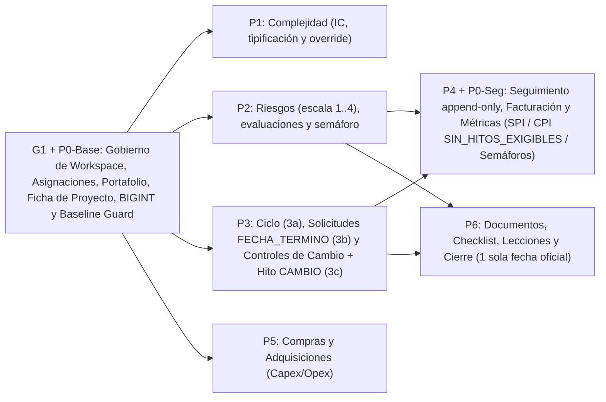

# Plan integral de implementación de políticas de negocio PMO (v2.1.0)

> **Estado:** Plan actualizado con decisiones aprobadas por el propietario y paquete inicial **G1** en ejecución.
> **Fecha:** 2026-11-06. **Baseline SQL inicial:** `app/api/migrations/011_pmo_cusn_v210.sql` (`pmo_cusn`, PostgreSQL 18.6, inmutable).
> **Fuentes contrastadas:**
> - `[I]` `specs/inventario-politicas-negocio-pmo.md` (60 reglas `BR-*`, rectificado el 2026-11-06).
> - `[E]` `C:\Users\Pedro Lopevia\Downloads\especificacion_logica_y_politicas_negocio_backend_bun.md` (SSOT funcional heredado).
> - `[F]` `C:\Users\Pedro Lopevia\Downloads\informe_flujos_funcionales_y_operativos_pmo.md` (flujos operativos F1.1–F7.2).
> - `[V]` `AGENTS.md`, `DEPLOY.md`, `specs/openapi-v210.json`, `specs/migracion-apps-script-a-bun.md`, código vigente en `app/api/src/**`, scripts `app/api/scripts/**` y suite `app/api/tests/**`.

---

## 1. Resumen ejecutivo y límites de alcance

Este plan define la secuencia técnica, contratos por capa, migraciones incrementales, gates de decisión y criterios de aceptación para implementar los dominios de negocio PMO sobre el monolito modular vigente (**Bun 1.4.4 + TypeScript + Hono 4.13.14 + PostgreSQL 18.6 + Drizzle 0.45.4 + Zod 4.6.7 / OpenAPI 3.1**).

### Principios y decisiones obligatorias vigentes

1. **Núcleo F1–F7 cerrado e intocable en su diseño (login propio):** autenticación propia con Argon2id y cookies HttpOnly, sesiones con rotación de refresh único, invitaciones y recuperación por entrega administrativa (sin SMTP ni correo automatizado), sin Google OIDC. La política de **refresh tokens multidispositivo permanece pendiente y fuera de alcance**. La suite `T01–T20` (`app/api/tests/v210-suite.ts`) es regresión obligatoria en cada entrega.
2. **Inmutabilidad del baseline `011` y serialización de catálogo:** `011_pmo_cusn_v210.sql` (SHA-256 `1086974ab85ca82c7919dec353a05394b7d97472fc9571341e19ecabd22cc40d`) no se modifica. Las migraciones `001–010` son históricas y no están activas; sus reglas aprobadas **se adaptan —no se copian ciegamente—** en nuevas migraciones secuenciales sin preasignar números rígidos por adelantado. Aunque varios paquetes puedan desarrollarse en paralelo en lógica de dominio/aplicación, **toda integración de migraciones SQL, actualización de `manifest.json`, `catalogSha256`, `verify-db.ts`, `models.ts`, `schema.ts` y grants de `bootstrap-db.ts` debe ejecutarse de forma estrictamente serializada**.
3. **Separación de equipos (prohibido tocar `app/src/`):** el frontend y sus layouts están a cargo de otro agente. Este plan y sus entregas backend no modifican `app/src/` ni construyen componentes visuales; exponen contratos HTTP/OpenAPI tipados y documentan la coordinación para que el frontend retire cálculos duplicados (`BR-SPI-027`).
4. **Primera entrega vertical `G1` antes de `P1` Complejidad:**
   - **`G1` (Gobierno de workspace, asignaciones, alta/edición base, consulta de portafolio y ficha de presentación del proyecto)** constituye la primera entrega vertical operativa sobre el núcleo F1–F7, **ubicada antes de `P1` Complejidad**.
   - **Límite de `G1`:** `G1` cubre gobierno, portafolio y ficha base del proyecto. Los indicadores **SPI/CPI, semáforos multidimensionales, riesgos, controles de cambio, ahorros/compras, checklist, lecciones, cierre y curva S se conectarán en los paquetes posteriores (`P1–P6`)**. En `G1` se prohíbe devolver datos de relleno sintético o usar `0` para representar "dato aún no calculado": toda métrica de módulos pendientes se expone como `null` o estado explícito no calculado.
5. **Decisiones de dominio ya fijadas por el propietario:**
   - **Solicitudes de cambio de planificación (`D-03` cerrada):** se limitan exclusivamente a **`FECHA_TERMINO`**. Solo el aprobador autorizado Head (`ADMIN`, poseedor de `cambios.aprobar`) resuelve y aplica `fecha_termino_actual` en la misma transacción; `fecha_termino_baseline` permanece inmutable. No se amplía a fecha de inicio ni a fechas de operación aunque el DDL de `011` contenga esos literales.
   - **CPI sin hitos exigibles (`D-05` fijada):** el CPI interno es **`null`** cuando no existen hitos planificados exigibles a la fecha de corte, reportando el estado explícito **`SIN_HITOS_EXIGIBLES`**; nunca se reporta `0`, `100` ni semáforo verde automático. Cuando existen hitos exigibles, se mantiene la fórmula interna por proyecto y unidad monetaria. *(No se implementa en `G1`; corresponde a `P4`).*
   - **Escala de riesgos (`D-08` acotada):** Probabilidad e Impacto de riesgos usan escala entera **`1..4`**; `severidad = P × I` (máximo `16`), tal como está en `011`. **Los umbrales de colores/niveles para la escala `1..16` requieren validación del negocio**, por lo que no se infieren ni se amplía la escala a `1..5`. *(No se implementa en `G1`; corresponde a `P2`).*
   - **Complejidad (`D-11` cerrada):** escala vigente **Bajo `1.0–2.5`, Medio `2.6–3.7`, Alto `3.8–4.4`, Estratégico `4.5–5.0`** con índice redondeado a una decimal. No existe divergencia de redondeo entre TypeScript y PostgreSQL en las 625 combinaciones (`1..5`). *(No se implementa en `G1`; corresponde a `P1`).*
   - **Temporalidad de cierre (`D-14` acotada):** existe **una sola fecha oficial de cierre**; no se persiste `periodo_cierre_mes` ni se duplican temporalidades (las fechas mensuales de `hito_facturacion` son independientes y se conservan). Queda pendiente únicamente definir la tabla/columna autoritativa del sellado de esa fecha única y el mecanismo de custodia de riesgo operacional. *(No se implementa en `G1`; corresponde a `P6`).*
   - **Cierre con riesgos transferidos (`D-10 / D-14` contradicción abierta):** se mantiene explícita como decisión pendiente la contradicción entre exigir todos los riesgos en `Controlado/Mitigado` para cerrar vs bifurcar a `'Cerrado con observaciones'` cuando existen riesgos con estrategia `'Transferir'`.
   - **Documentos en Google Drive (`S-02 / D-15`):** almacenar un `drive_file_id` o metadato en `documento` **no prueba** existencia, integridad de contenido ni permisos reales en Google Drive; no debe confundirse referencia documental con evidencia validada.

---

## 2. Baseline y observaciones verificadas

### 2.1. Recuento exacto verificado fila por fila del inventario (`60` reglas `BR-*`)

Se mantienen las 60 reglas únicas de `specs/inventario-politicas-negocio-pmo.md` con sus totales reales verificados fila por fila:
- **Estado funcional (60):** `51 Aprobada` / `4 Propuesta` (`BR-SPI-020`, `BR-SPI-021`, `BR-FIN-045`, `BR-COMPRA-073`) / `3 Ambigua` (`BR-RIESGO-031`, `BR-RIESGO-034`, `BR-CIERRE-084`) / `2 Aplazada` (`BR-RIESGO-035`, `BR-OPER-097`).
- **Estado de implementación en el punto de partida (60):** `19 Implementada` / `26 Parcial` / `5 Divergente` (`BR-SPI-025`, `BR-SPI-027`, `BR-RIESGO-031`, `BR-COMPRA-070`, `BR-CIERRE-082`) / `10 Ausente` (`BR-CICLO-007`, `BR-CRONO-010`, `BR-SPI-021`, `BR-RIESGO-035`, `BR-FIN-043`, `BR-FIN-045`, `BR-CC-063`, `BR-CIERRE-084`, `BR-CIERRE-085`, `BR-OPER-097`).

### 2.2. Condiciones del arnés técnico v2.1.0

1. **Migraciones y verificación de catálogo:** `app/api/scripts/migrate.ts`, `catalog.ts`, `verify-db.ts` y `generate-models.ts` verifican el SHA-256 de cada migración en `manifest.json`, la huella determinista `catalogSha256` del catálogo PostgreSQL y la sincronía con `app/api/src/models.ts` y `app/api/src/infrastructure/database/schema.ts`.
2. **Privilegios runtime mínimos (`bootstrap-db.ts`):** el rol runtime solo posee `SELECT` en `pmo_cusn`, `INSERT, UPDATE` en las 9 tablas de acceso/gobierno e `INSERT` en `evento_proyecto` y `auditoria_seguridad`. En `G1` **no se amplían grants sobre tablas de otros dominios ni sobre catálogos protegidos**; cada paquete futuro (`P1–P6`) habilitará únicamente los permisos DML mínimos de sus tablas.
3. **Cota superior `BIGINT` en frontera (`contracts.ts`):** los esquemas `id` y `cursor` deben rechazar con `422 INVALID_FIELD` cualquier entero positivo mayor que `9223372036854775807` antes de invocar consultas SQL.
4. **Corrección de suplencias para titular reasignado (`substitution.ts`):** `assertDesignator` exigía que el `PM` fuera simultáneamente `ownerId` y `creatorId`, impidiendo que un `PM_TITULAR` asignado por Head o por transferencia designara suplencias. En `G1` se corrige para exigir `project.ownerId === actorId` (o rol `ADMIN`).

---

## 3. Cobertura de las 60 reglas `BR-*`

Clasificación de acción en el plan:
- **(Cerrada):** implementada y verificada en el baseline; se mantiene en regresión.
- **(G1):** cubierta o ampliada en la primera entrega vertical `G1` (gobierno de workspace, asignaciones, alta/ficha de proyecto, portafolio y prerrequisitos `P0` de cota `BIGINT` y guarda de baseline).
- **(a) Restaurar SQL:** invariante aprobada presente solo en migraciones históricas `007–010`, a incorporar adaptada en `P0/G1` o `P1–P6`.
- **(b) Integrar servicio/API:** función pura en `domain/*` o tabla en `011` pendiente de conectar en `P1–P6`.
- **(c) Reparar divergencia:** discrepancia comprobada a corregir en su paquete.
- **(d) Condicionada por Gate:** sujeta a decisión pendiente del negocio (`D-*`).
- **(e) Propuesta / Aplazada:** fuera de alcance ejecutable.

| ID | Dominio | Estado Inv. (Func. / Impl.) | Clasificación y destino en el plan | Entrega / Paquete | Evidencia verificada (`archivo:línea`) |
|---|---|---|---|---|---|
| `BR-CICLO-001` | CICLO | Aprobada / Implementada | **(Cerrada) + (G1 portafolio/ficha)** — 7 estados canónicos en BD, portafolio y ficha (`D-01` por confirmar glosario sin alterar CHECK) | `G1` | `011:306–308`; `domain.ts:1`; `models.ts:411` |
| `BR-CICLO-002` | CICLO | Aprobada / Implementada | **(Cerrada) + (G1 atributos base)** — Alta atómica + `tvt_normalizado` UNIQUE + atributos iniciales de ficha y `evento_proyecto` | `G1` | `application/projects/create.ts:28–34`; `011:282–283` |
| `BR-CICLO-003` | CICLO | Aprobada / Implementada | **(Cerrada) + (G1 consultas elegibilidad/asignaciones)** — Titular PM único, elegible y sin solapes | `G1` | `011:375–382,1043–1127`; `transfer.ts:20–29` |
| `BR-CICLO-004` | CICLO | Aprobada / Parcial | **(G1 filtro Head en portafolio) + (b) Endpoint desactivar en `P3`** — Portafolio en `G1` filtra `activo` y permite a Head consultar inactivos; mutación de desactivación en `P3` | `G1` (lectura) / `P3` (mutación) | `repositories/projects.ts:12`; `business-routes.ts:138–139`; `011:155` |
| `BR-CICLO-005` | CICLO | Aprobada / Implementada | **(Cerrada)** — `evento_proyecto` append-only | Regresión (`T18`) | `011:1031–1039` (`tr_evento_proyecto_inmutable`) |
| `BR-CICLO-006` | CICLO | Aprobada / Implementada | **(Cerrada)** — `auditoria_seguridad` append-only | Regresión (`T18`) | `011:1148–1156` (`tr_auditoria_seguridad_inmutable`) |
| `BR-CICLO-007` | CICLO | Aprobada / Ausente | **(b)+(d) Condicionada por Gate** — Matriz de transición de estados y efectos de `Detenido`/`En transición` (`D-02`) | `P3` (Gate `D-02`) | `AGENTS.md:30–32`; sin servicio de transición de estado |
| `BR-CRONO-010` | CRONO | Aprobada / Ausente | **(a) Restaurar SQL en `G1/P0`** — Inmutabilidad de primera `fecha_termino_baseline` por trigger en BD y validación en edición de ficha | `G1 / P0` | `[H] 008:12–18` adaptado en migración secuencial sobre `011` |
| `BR-CRONO-011` | CRONO | Aprobada / Parcial | **(b) Integrar servicio/API (`D-03` cerrada)** — Solicitudes limitadas exclusivamente a `FECHA_TERMINO`; solo Head aplica `fecha_termino_actual` en TX preservando baseline | `P3` (`D-03` cerrada) | `011:693–723`; decisión `D-03` |
| `BR-CRONO-012` | CRONO | Aprobada / Implementada | **(Cerrada en BD) + (b) Integrar API** — Constraints y triggers de solicitud activos en `011`; se expone en API en `P3` | `P3` | `011:709–781` (`tr_validar_cc_solicitud`, `tr_proteger_solicitud_resuelta`) |
| `BR-CRONO-013` | CRONO | Aprobada / Parcial | **(b) Integrar servicio/API** — `baselineDeviation()` puro existente; conectar en `P4` | `P4` | `domain/performance/index.ts:19`; `unit/business.test.ts:35` |
| `BR-CRONO-014` | CRONO | Aprobada / Implementada | **(Cerrada) + (G1 coherencia `fecha_termino_actual`)** — `ck_proyecto_fechas` activo; `G1` valida coherencia de fechas en alta y edición | `G1` | `011:309–311` |
| `BR-SPI-020` | SPI | Propuesta / Parcial | **(d) Condicionada por Gate** — Semántica `plan=0`, tope `>100%` y escala decimal (`D-04`) | `P4` (Gate `D-04`) | `domain/performance/index.ts:4–13` vs `[E] §7.1` |
| `BR-SPI-021` | SPI | Propuesta / Ausente | **(d)/(e) Condicionada por Gate** — Decidir si SPI se persiste como columna generada o se calcula solo en Dominio (`D-04`) | `P4` (Gate `D-04`) | `[H] 007:49–53`; ausente en `011:502–513` |
| `BR-SPI-022` | SPI | Aprobada / Parcial | **(b)+(d) Integrar servicio/API** — Conectar `spi()` a lecturas/seguimiento tras fijar `D-04` | `P4` (Gate `D-04`) | `domain/performance/index.ts:4–13`; `unit/business.test.ts:19–24` |
| `BR-SPI-023` | SPI | Aprobada / Parcial | **(b) Integrar servicio/API (`D-05` fijada)** — CPI es `null` con estado `SIN_HITOS_EXIGIBLES` cuando no hay hitos exigibles al corte; por proyecto y moneda | `P4` (`D-05` fijada) | `domain/performance/index.ts:14–18`; decisión `D-05` |
| `BR-SPI-024` | SPI | Aprobada / Parcial | **(b) Integrar servicio/API** — Conectar `performanceLight()` respetando `SIN_HITOS_EXIGIBLES` (nunca verde automático sin hitos) | `P4` | `domain/health/index.ts:2–7`; decisión `D-05` |
| `BR-SPI-025` | SPI | Aprobada / Divergente | **(c)+(d) Reparar divergencia + Integrar** — Orden de guardas en `riskLight()` ante severidades `null` (`D-06`) y umbrales (`D-08`) | `P2` (Gates `D-06, D-08`) | `domain/health/index.ts:8–14`; `unit/business.test.ts:40–43` |
| `BR-SPI-026` | SPI | Aprobada / Parcial | **(b) Integrar servicio/API** — Conectar `qualityLight()` a conteo de contingencias y CCs abiertos | `P4` (req. `P2,P3`) | `domain/health/index.ts:15–18`; `unit/business.test.ts:44` |
| `BR-SPI-027` | SPI | Aprobada / Divergente | **(c) Coordinación Frontend** — Duplicación en `app/src/data/business.ts`; el backend expone resultados autoritativos en DTOs para que el equipo frontend retire cálculo local | `P4 / P5 / P6` (Contrato FE) | `app/src/data/business.ts:1–23`; `tests/business.test.ts:1–13` |
| `BR-RIESGO-030` | RIESGO | Aprobada / Parcial | **(b)+(d) Integrar servicio/API** — `severidad = P * I` (máx `16` con escala `1..4`); umbrales de colores/niveles pendientes de validación (`D-08`) | `P2` (Gate `D-08`) | `011:631`; decisión `D-08` |
| `BR-RIESGO-031` | RIESGO | Ambigua / Divergente | **(c)+(d) Escala `1..4` fijada; umbrales pendientes (`D-08`)** — Probabilidad e Impacto fijados en `1..4` (`S` máx `16`); validar umbrales de color antes de implementar `P2` | `P2` (Gate `D-08`) | `011:211–212,629–630`; decisión `D-08` |
| `BR-RIESGO-032` | RIESGO | Aprobada / Parcial | **(b)+(d) Integrar + Gate** — Filtro por proyecto en cierre existe; modelo de riesgo transversal requiere `D-09` | `P2` (Gate `D-09`) | `011:604–620`; `domain/closure/index.ts:4`; `[H] 007:20–25` |
| `BR-RIESGO-033` | RIESGO | Aprobada / Parcial | **(b)+(d) Integrar servicio/API** — Estrategias en `011`; efecto de `'Transferir'` al cerrar sujeto a resolver contradicción en `D-10` | `P2` y `P6` (Gate `D-10`) | `011:614–615`; `domain/closure/index.ts:10` |
| `BR-RIESGO-034` | RIESGO | Ambigua / Implementada | **(Cerrada en BD) + (d) Gate** — `tipo_evaluacion` activo en `011`; regla de paso a `Controlado` sujeta a `D-10` | `P2` (Gate `D-10`) | `011:622–633,1165` |
| `BR-RIESGO-035` | RIESGO | Aplazada / Ausente | **(e) Aplazada** — Oportunidades como tipo de riesgo fuera de alcance | Excluida | `011:604–620` (sin columna `tipo`) |
| `BR-FIN-040` | FIN | Aprobada / Implementada | **(Cerrada en BD) + (b) Integrar API** — `hito_facturacion` y `ck_facturacion_mes` activos; servicio/endpoints en `P4` | `P4` | `011:552–569,1162` |
| `BR-FIN-041` | FIN | Aprobada / Implementada | **(Cerrada en BD) + (b) Integrar API** — `condicion_comercial` y `ck_condicion_tcv` activos; conectar en `P3` y `P4` | `P3` y `P4` | `011:539–550` |
| `BR-FIN-042` | FIN | Aprobada / Implementada | **(Cerrada)** — 9 unidades monetarias en `011` (`margen_porcentaje` histórico queda sujeto a `D-05b`) | Regresión / `P4` | `011:23–35`; `domain.ts:4` |
| `BR-FIN-043` | FIN | Aprobada / Ausente | **(a) Restaurar SQL + (b) Integrar** — Vínculo `hito_facturacion <-> control_cambio`, `ck_hito_origen_valido`, FK compuesta y unicidad de aporte por CC | `P3` | `[H] 007:27–46`; `[H] 008:9–10`; ausente en `011:552–569` |
| `BR-FIN-044` | FIN | Aprobada / Parcial | **(b) Integrar servicio/API** — `sumAmounts()` y `money.ts` puros; usar en agregaciones por proyecto y unidad monetaria | `P4` | `domain.ts:9–19`; `domain/shared/money.ts:1–41` |
| `BR-FIN-045` | FIN | Propuesta / Ausente | **(e) Propuesta no aprobada** — Exportaciones Excel/Word y presentaciones Google Slides fuera de corte | Excluida | `[F] 6.2–6.3`; `specs/migracion-apps-script-a-bun.md:313` |
| `BR-COMPLEJ-050` | COMPLEJ | Aprobada / Parcial | **(b) Integrar servicio/API (`D-11` cerrada)** — Fórmula V1 coincide en SQL y TS para las 625 combinaciones; conectar en `P1` | `P1` | `011:806–828`; `domain/complexity/index.ts:3–9` |
| `BR-COMPLEJ-051` | COMPLEJ | Aprobada / Parcial | **(a)/(c) Completar constraint SQL + (b) Integrar (`D-11` cerrada)** — Bajo `1.0–2.5`, Medio `2.6–3.7`, Alto `3.8–4.4`, Estratégico `4.5–5.0`; agregar `CHECK` `tipificacion <-> indice_complejidad` en `P1` | `P1` | `domain/complexity/index.ts:7`; `011:820–832` |
| `BR-COMPLEJ-052` | COMPLEJ | Aprobada / Parcial | **(b) Integrar servicio/API** — `ck_complejidad_override` activo; verificar permiso `complejidad.override` en `P1` | `P1` | `011:170,829–832`; `domain/complexity/index.ts:5` |
| `BR-CC-060` | CC | Aprobada / Parcial | **(b)+(d) Integrar servicio + Gate** — Unicidad `(proyecto_id, secuencia/folio)` activa; generación correlativa `{TVT}-CC-{SEQ:003}` y `CHECK` opcional (`D-CC`) | `P3` (Gate `D-CC`) | `011:654–677` |
| `BR-CC-061` | CC | Aprobada / Implementada | **(Cerrada en BD) + (b) Integrar API** — `ck_cc_moneda` y `ck_cc_responsables` activos en `011`; validar en DTO Zod en `P3` | `P3` | `011:678–685` |
| `BR-CC-062` | CC | Aprobada / Parcial | **(b) Integrar servicio/API (`D-03` cerrada)** — Solo Head (`cambios.aprobar`) resuelve solicitudes de `FECHA_TERMINO` y actualiza `fecha_termino_actual` en TX | `P3` (`D-03` cerrada) | `011:168,693–723`; decisión `D-03` |
| `BR-CC-063` | CC | Aprobada / Ausente | **(a)+(b)+(d) Restaurar SQL + Integrar servicio** — Aprobación económica de CC exige `periodo_facturacion YYYY-MM`, crea hito `CAMBIO` y actualiza TCV según `D-CC` | `P3` (Gate `D-CC`) | `[H] 007:27–46`; `[E] §5.2`; ausente en `011` |
| `BR-CC-064` | CC | Aprobada / Parcial | **(a) Restaurar SQL** — `011:784–803` protege CC consumido por fecha; restaurar `proteger_economia_cc_aprobado` (`008`) y trazabilidad económica (`009`) en `P3` | `P3` | `011:784–803`; `[H] 008:36–49`; `[H] 009:1–25` |
| `BR-COMPRA-070` | COMPRA | Aprobada / Divergente | **(c)+(d) Reparar divergencia + Integrar** — Alinear estados de etapa documental (`Pendiente / Solicitada / BORP / SOLPED / OC / OK`) según `D-12` | `P5` (Gate `D-12`) | `domain/procurement/index.ts:3,6–7`; `011:590–601` |
| `BR-COMPRA-071` | COMPRA | Aprobada / Parcial | **(a) Restaurar SQL + (b) Integrar** — Restaurar `presupuesto` y `ahorro GENERATED ALWAYS` de `007:3–10`; conectar `purchaseTotal()` y `savings()` en `P5` | `P5` | `domain/procurement/index.ts:4–5`; `[H] 007:3–10`; `011:572–588` |
| `BR-COMPRA-072` | COMPRA | Aprobada / Implementada | **(Cerrada en BD) + (b) Integrar API** — CHECKs de importes `>= 0`, `CAPEX/OPEX` y moneda activos en `011` | `P5` | `011:572–588` |
| `BR-COMPRA-073` | COMPRA | Propuesta / Parcial | **(d)/(e) Condicionada por Gate** — Columnas `fecha_recepcion_esperada/real` (`007:4–5`) y `leadTime()` sujetas a confirmación en `D-12` | `P5` (Gate `D-12`) | `domain/procurement/index.ts:8`; `[H] 007:4–5` |
| `BR-CIERRE-080` | CIERRE | Aprobada / Parcial | **(b)+(d) Integrar servicio/API** — Evaluar checklist al 100% (`obligatorio` y fases en `D-13`) | `P6` (Gate `D-13`) | `domain/closure/index.ts:5`; `011:917–929` |
| `BR-CIERRE-081` | CIERRE | Aprobada / Parcial | **(b)+(d) Integrar servicio/API** — Acreditar `>= 1` lección aprendida con `titulo` y `leccion` no vacíos (`D-13`) | `P6` (Gate `D-13`) | `domain/closure/index.ts:7`; `011:862–876` |
| `BR-CIERRE-082` | CIERRE | Aprobada / Divergente | **(c)+(d) Reparar divergencia + Integrar** — Resolver contradicción entre bloqueo por riesgos no mitigados/controlados y riesgos con estrategia `'Transferir'` (`D-10`) | `P6` (Gate `D-10`) | `domain/closure/index.ts:8–10`; `011:612–615` |
| `BR-CIERRE-083` | CIERRE | Aprobada / Parcial | **(b)+(d) Integrar servicio/API** — Bifurcación a `Cerrado con observaciones` / `Cerrado exitoso` sujeta a la resolución de contradicción en `D-10` | `P6` (Gate `D-10`) | `domain/closure/index.ts:10` |
| `BR-CIERRE-084` | CIERRE | Ambigua / Ausente | **(a)+(b)+(d) Condicionada por Gate (`D-14` acotada)** — Una sola fecha oficial de cierre (sin `periodo_cierre_mes`); definir tabla/columna autoritativa del sellado y custodia de riesgo operacional (`D-14`) | `P6` (Gate `D-14`) | `domain/projects/state.ts:5–7`; decisión `D-14` |
| `BR-CIERRE-085` | CIERRE | Aprobada / Ausente | **(a) Restaurar SQL** — Triggers `impedir_evidencia_de_proyecto_cerrado` e `impedir_archivar_evidencia_de_cierre` (`010`) en `P6` | `P6` | `[H] 010:1–60`; ausente en `011` |
| `BR-CIERRE-086` | CIERRE | Aprobada / Implementada | **(Cerrada en BD) + (b) Integrar API** — `ck_cierre_apto` activo en `011`; conectar en `P6` | `P6` | `011:940–956` |
| `BR-CIERRE-087` | CIERRE | Aprobada / Parcial | **(b)+(d) Integrar servicio/API** — Ítem con `requiere_documento = true` exige evidencia validada (un `drive_file_id` por sí solo no acredita existencia ni permisos reales en Drive; ver `D-13`, `D-15`) | `P6` (Gates `D-13, D-15`) | `domain/closure/index.ts:6`; `011:879–937` |
| `BR-OPER-090` | OPER | Aprobada / Implementada | **(Cerrada) + (G1 validación fechas civiles)** — `civilDate()`, `santiagoDate()`, `timestamptz` UTC e instantes con offset obligatorio | `G1` / Regresión | `domain/shared/civil-date.ts:1–18`; `unit/business.test.ts:63–67` |
| `BR-OPER-091` | OPER | Aprobada / Parcial | **(a) Restaurar SQL + (b) Integrar API** — CHECKs `0..100` activos en `011`; el trigger `impedir_mutacion_seguimiento` y el endpoint de seguimiento se integran juntos en `P0-S / P4` | `P0-S / P4` | `011:502–513`; `[H] 008:30–34` |
| `BR-OPER-092` | OPER | Aprobada / Implementada | **(Cerrada en BD)** — `servicio_operativo` `0..1` por proyecto y coherencia de fechas | Regresión / `P3` | `011:527–536` |
| `BR-OPER-093` | OPER | Aprobada / Implementada | **(Cerrada) + (G1 corrección titular reasignado)** — Suplencias PM UTC `[inicio, fin)` sin solapes; en `G1` se elimina la restricción que exigía ser también creador original del proyecto | `G1` | `application/projects/substitution.ts:15`; `011:386–415` |
| `BR-OPER-094` | OPER | Aprobada / Implementada | **(Cerrada) + (G1 edición ficha base)** — Versionado optimista e inmutabilidad de `id`/`tvt` en edición y transferencia | `G1` | `repositories/projects.ts:15–18`; `edit.ts`; `transfer.ts` |
| `BR-OPER-095` | OPER | Aprobada / Implementada | **(Cerrada) + (G1 cota `BIGINT`)** — Contratos Zod estrictos, límite 8 KB y `Origin`; en `G1` se agrega cota superior `MAX_BIGINT` (`9223372036854775807`) en `id`/`cursor` | `G1 / P0` | `infrastructure/http/contracts.ts:4–5`; `business-routes.ts:52–98` |
| `BR-OPER-096` | OPER | Aprobada / Parcial | **(G1 permisos contextuales en ficha/portafolio/workspaces) + (b)+(d) Resto de dominios** — `hasGrant`/`hasPermission` operativos en `G1`; `documentos.*` permanece denegado hasta resolver `D-15` | `G1` y `P1–P6` | `authorization.ts:16–65`; `011:142–180,439–459` |
| `BR-OPER-097` | OPER | Aplazada / Ausente | **(e) Aplazada** — Horas, especialistas, asignaciones/repases, tarifas, SSO y notificaciones masivas fuera de alcance | Excluida | `011:1180–1181`; `[E]` portada |

---

## 4. Secuencia de implementación, dependencias y paquetes detallados

### 4.1. Grafo de dependencias y serialización de migraciones

- **Partición de `P0`:**
  - **`P0-Base` (integrado en `G1`):** habilitación de migraciones secuenciales en `migrate.ts`/`verify-db.ts`, cota `MAX_BIGINT` (`9223372036854775807`) en todos los identificadores/cursores de frontera (`BR-OPER-095`), coherencia de fechas y trigger de inmutabilidad de primera línea base `fecha_termino_baseline` (`BR-CRONO-010`).
  - **`P0-Seg` (integrado con `P4`):** el trigger append-only `impedir_mutacion_seguimiento` (`BR-OPER-091`) permanece junto al paquete `P4` cuando se habilite el grant `INSERT` sobre `seguimiento_proyecto` (mientras tanto, en `G1`, el rol runtime no tiene `INSERT` ni `UPDATE` ni `DELETE` sobre `seguimiento_proyecto`).
- **Regla de paralelismo vs serialización:** `P1`, `P2`, `P3` y `P5` pueden desarrollarse en paralelo en código de dominio, pero **las migraciones SQL, el cálculo de `catalogSha256`, la regeneración de `models.ts`/`schema.ts` y la actualización de `bootstrap-db.ts` se integran siempre en serie**, asignando el número correlativo siguiente al momento de integrar.

### 4.2. Tabla consolidada de fases y paquetes

| Paquete | Prioridad | Dependencia técnica | Gates requeridos | Criterio de terminación |
|---|---|---|---|---|
| **G1 (incluye P0-Base) — Gobierno de workspace, asignaciones, alta/edición base, portafolio denso y ficha del proyecto** | **G1 (En ejecución actual)** | Baseline `011` | **Ninguno (0)** | Migración secuencial `012` aplicada (baseline inmutable + coherencia `fecha_termino_actual`); cota `BIGINT` `<= 9223372036854775807` -> `422`; titular reasignado puede designar suplencias; lecturas de workspace/miembros/invitaciones (sin tokens)/elegibles/catálogos, portafolio filtrado/paginado y ficha de proyecto con permisos contextuales y confidencialidad de externos verificados sobre PostgreSQL 18.6. |
| **P1 — Índice de Complejidad (IC), coherencia de tipificación y override** | P1 | `G1` | **Ninguno (`D-11` cerrada)** | Constraint SQL `tipificacion <-> indice_complejidad` (`1.0–2.5` Bajo, `2.6–3.7` Medio, `3.8–4.4` Alto, `4.5–5.0` Estratégico); historial append-only; endpoints `GET/POST /api/v1/proyectos/:id/complejidad` con `complejidad.evaluar` y `complejidad.override`. |
| **P2 — Riesgos de proyecto/portafolio (escala `1..4`), evaluaciones y semáforo** | P2 | `G1` | `D-06`, `D-08` (umbrales), `D-09`, `D-10` | Escala `1..4` (`S` máx `16`) conservada; umbrales validados aplicados en `riskLight`; soporte de riesgos transversales según `D-09`; CRUD de riesgos y evaluaciones. |
| **P3 — Ciclo de vida (3a), Solicitudes de `FECHA_TERMINO` (3b) y Controles de Cambio + inyección financiera (3c)** | P2 | `G1` | `D-01`, `D-02`, `D-CC` (`D-03` ya cerrada) | Entregable por subflujos: **(3b)** solicitudes y resolución por Head exclusivamente para `FECHA_TERMINO` (`D-03` cerrada, ejecutable sin esperar `D-CC`); **(3c)** folios `{TVT}-CC-{SEQ:003}`, inmutabilidad económica e inyección en `hito_facturacion` con `periodo YYYY-MM` obligatorio; **(3a)** transiciones de estado (`D-02`) y activación/desactivación por Head. |
| **P4 (incluye P0-Seg) — Seguimiento append-only, matriz de facturación e indicadores SPI/CPI/Semáforos** | P3 | `G1`, `P2`, `P3` | `D-04`, `D-05b` (`D-05` CPI nulo ya cerrada) | Trigger `impedir_mutacion_seguimiento` activo; registro de seguimiento y facturación por moneda; `cpi()` devuelve `null` con estado `SIN_HITOS_EXIGIBLES` cuando no hay hitos vencidos al corte (`D-05`); semáforos multidimensionales operativos. |
| **P5 — Compras y Adquisiciones (Capex/Opex, etapas, ahorro y lead time)** | P3 | `G1` | `D-12` | Columnas `presupuesto` y `ahorro` generado (adjudicación `0` válida -> ahorro `100%`); etapas `BORP -> SOLPED -> OC -> CONFORMIDAD` y endpoints con `compras.gestionar`. |
| **P6 — Documentos, Checklist, Lecciones Aprendidas y Protocolo de Cierre** | P4 | `G1`, `P2`, `P3` | `D-10`, `D-13`, `D-14`, `D-15` | Triggers de inmutabilidad de evidencia de proyecto cerrado; **una sola fecha oficial de cierre** (sin `periodo_cierre_mes`); distinción entre metadato `drive_file_id` y evidencia validada; cierre transaccional en cascada. |

---

### 4.3. Fichas detalladas por paquete

#### Paquete G1 (incluye P0-Base) — Gobierno de workspace, asignaciones, alta/edición base, portafolio y ficha del proyecto
- **Objetivo y valor operativo:** completar de punta a punta el flujo vertical inicial (`workspaces -> miembros/invitaciones/elegibles -> alta y edición base de proyecto -> consulta densa de portafolio -> ficha de presentación del proyecto`), cerrando además `BR-CRONO-010` (inmutabilidad de primera línea base de término), `BR-OPER-095` (cota `MAX_BIGINT`) y la corrección de `BR-OPER-093` (suplencia designada por titular reasignado).
- **Prerrequisitos:** baseline `011` activo. **0 Gates pendientes.**
- **Subflujos y trabajo por capa:**
  - **G1.0 / P0-Base (Migración `012_g1_baseline_guard.sql` y cota `BIGINT`):**
    - En `app/api/scripts/migrate.ts`: autorizar la lista ordenada de archivos de `manifest.migrations` (manteniendo `011` como primer archivo obligatorio).
    - En `012_g1_baseline_guard.sql`: función `pmo_cusn.proteger_baseline_termino()` y trigger `tr_proteger_baseline_termino BEFORE UPDATE ON pmo_cusn.proyecto` que impide modificar `fecha_termino_baseline` cuando `OLD.fecha_termino_baseline IS NOT NULL`, más `CONSTRAINT ck_proyecto_fecha_termino_actual CHECK (fecha_inicio IS NULL OR fecha_termino_actual IS NULL OR fecha_termino_actual >= fecha_inicio)`.
    - En `app/api/src/infrastructure/http/contracts.ts`: validar que todo `id` y `cursor` sea `<= 9223372036854775807n` (`MAX_BIGINT`), devolviendo `422 INVALID_FIELD` antes de llegar a SQL.
  - **G1.1 (Workspaces, detalle, miembros e invitaciones seguras):**
    - Ampliar `GET /api/v1/workspaces` con paginación y búsqueda opcional (`after`, `limit`, `q`), conservando su respuesta de arreglo para compatibilidad total con `T01–T20`.
    - `GET /api/v1/workspaces/:id`: detalle del workspace para `ADMIN` o miembro activo (`403` para usuarios sin membresía activa), incluyendo `miMembresia`, `permisos` contextuales (`puedeConfigurar`, `puedeCrearProyectos`, `puedeInvitar`, `puedeGestionarMiembros`) y conteos de resumen (`miembrosActivos`, `proyectosActivos`, `invitacionesPendientes`).
    - `GET /api/v1/workspaces/:id/miembros`: lista paginada y filtrable (`after`, `limit`, `estado`, `rol`, `q`) de miembros del workspace con su rol corporativo, estado de membresía y flag `esElegibleTitular` (oculta correos internos cuando el actor es `EXTERNO`).
    - `GET /api/v1/workspaces/:id/invitaciones`: lista paginada y filtrable (`after`, `limit`, `estado`) para `ADMIN` o `PM` creador/habilitado del workspace, **sin exponer jamás `token` ni `token_hash`**.
  - **G1.2 (Asignaciones, titulares y suplencias):**
    - Corregir `app/api/src/application/projects/substitution.ts`: permitir que el `PM_TITULAR` vigente (`project.ownerId === actorId`) o `ADMIN` designe y revoque suplencias aunque el proyecto haya sido creado originalmente por otro usuario o reasignado por transferencia.
    - `GET /api/v1/proyectos/:id/asignaciones`: devuelve de forma separada `titular`, `participantes` activos (`ESPECIALISTA`, `OBSERVADOR`, `LIDER_TECNICO`, `TAM`, `SDM`), `suplencias` (activas/pendientes con sus permisos delegados) y catálogo `permisosDelegables`, aplicando confidencialidad para actores `EXTERNO`.
  - **G1.3 (Creación y edición de datos base del proyecto):**
    - Ampliar `POST /api/v1/proyectos` para aceptar opcionalmente `squadId`, `descripcion`, `situacionInicial`, `fechaRecepcionP1p2`, `fechaInicio`, `fechaTerminoBaseline`, `referenciaSap`, `referenciaCeco`, `referenciaPep`. Valida fechas civiles (`YYYY-MM-DD`), coherencia `fechaTerminoBaseline >= fechaInicio`, existencia y estado `activo` de `cliente`, `pais`, `lob` y `squad`. Si se envía `fechaTerminoBaseline`, inicializa `fecha_termino_actual = fechaTerminoBaseline`. Registra `evento_proyecto` (`CREACION_PROYECTO`) además de `auditoria_seguridad`.
    - Ampliar `PATCH /api/v1/proyectos/:id` para editar con versión optimista `nombre`, `descripcion`, `situacionInicial`, `squadId`, `fechaRecepcionP1p2`, `fechaInicio`, `fechaTerminoBaseline` (solo fijable cuando era `NULL`; si ya existía y cambia, responde `409 BASELINE_IMMUTABLE`) y referencias `referenciaSap/Ceco/Pep`, manteniendo prohibidos `tvt`, `workspaceId`, `clienteId`, `paisId`, `lobId`, `pmTitularId`, `estado` y `fechaTerminoActual`.
  - **G1.4 (Portafolio denso):**
    - Conservar `GET /api/v1/proyectos` intacto (`after`, `limit`) para no alterar contratos de `T01–T20`.
    - Añadir `GET /api/v1/portafolio` y `GET /api/v1/workspaces/:id/proyectos` con búsqueda (`q` en TVT, nombre y cliente), filtros (`workspaceId`, `paisId`, `lobId`, `squadId`, `clienteId`, `pmTitularId`, `estado`, `incluirInactivos` exclusivo `ADMIN`), ordenamiento seguro por lista cerrada (`id`, `tvt`, `nombre`, `cliente`, `estado`, `fechaTerminoActual`, `updatedAt`, `asc|desc`), paginación determinista (`limit`, `offset`, `total`, `hasMore`) y `resumenPorEstado` calculado sobre el mismo universo autorizado.
  - **G1.5 (Ficha de presentación / vista general del proyecto):**
    - Enriquecer `GET /api/v1/proyectos/:id` preservando `{ id, tvt, nombre, workspaceId, version, estado }` en la raíz y añadiendo los bloques tipados `identidad`, `gobierno`, `planificacion`, `accionesDisponibles` (permisos contextuales reales del actor sobre el proyecto) y `modulosPendientes` (`null` / pendientes para P1–P6, sin simular métricas). Para usuarios `EXTERNO`, restringe `referenciasInternas` (`sap/ceco/pep`) y correos internos a `null`.
  - **G1.6 (Recursos independientes de selección y elegibles; rectificación del propietario):**
    - `GET /api/v1/clientes?q&limit&after`: clientes activos, búsqueda parcial literal insensible a mayúsculas, cursor numérico por ID ascendente; `{items,paginacion:{limit,total,hasMore,nextCursor}}`. Lectura limitada a ADMIN/PM internos activos con `proyectos.consultar`.
    - `POST /api/v1/clientes` con `{nombre}`: trim, 1–200 caracteres; `201 {data:{id,nombre,sector:null}}`. Reutiliza `cliente` de 011, permite nombres repetidos y audita cada identidad nueva. Exige rol/tipo vigente y `clientes.crear` por separado.
    - `GET /api/v1/paises` y `GET /api/v1/lobs`: listas completas de registros activos preestablecidos, conservando la lectura G1 interna con `proyectos.consultar`; sin alta/edición/baja.
    - Se retira el recurso agregado anterior y sus derivados (404, sin alias/OpenAPI). `servicio_lob`, `squad` y otros maestros no reciben endpoints por esta rectificación; sus FKs/lecturas de ficha existentes se conservan.
    - `GET /api/v1/workspaces/:id/elegibles`: consulta acotada para `ADMIN` o `PM` activo del workspace para seleccionar candidatos elegibles según `para` (`PM_TITULAR | SUPLENTE_PM | ESPECIALISTA | OBSERVADOR`).

---

#### Paquete P1 — Índice de Complejidad (IC), coherencia de tipificación y override
- **Objetivo y valor operativo:** cubrir `BR-COMPLEJ-050`, `BR-COMPLEJ-051` y `BR-COMPLEJ-052` con la escala aprobada (**Bajo `1.0–2.5`, Medio `2.6–3.7`, Alto `3.8–4.4`, Estratégico `4.5–5.0`**), imponiendo en PostgreSQL la coherencia `tipificacion <-> indice_complejidad`, historial append-only y verificación del permiso `complejidad.override`.
- **Prerrequisitos:** `G1` completado. **0 Gates pendientes (`D-11` cerrada).**
- **Cambios SQL:** migración secuencial con `ck_complejidad_v1_tipificacion` y trigger `impedir_mutacion_evaluacion_complejidad`; `GRANT INSERT ON pmo_cusn.evaluacion_complejidad` en `bootstrap-db.ts`.
- **Contratos API:** `GET /api/v1/proyectos/:id/complejidad` y `POST /api/v1/proyectos/:id/complejidad`.

---

#### Paquete P2 — Riesgos de proyecto/portafolio (escala `1..4`), evaluaciones y semáforo
- **Objetivo y valor operativo:** cubrir `BR-RIESGO-030` a `BR-RIESGO-034` y `BR-SPI-025` con escala **`1..4`** y `severidad = P × I` (máximo `16`, decisión `D-08`).
- **Prerrequisitos:** `G1` completado + resolución de **`D-06`** (precedencia `null` en `riskLight`), **`D-08`** (validación de los umbrales de colores/niveles sobre escala `1..16`), **`D-09`** (modelo de riesgo transversal) y **`D-10`** (semántica de `'Controlado'` y contradicción con `'Transferir'`).
- **Cambios SQL y API:** migración secuencial según `D-09`/`D-10` (sin cambiar la escala `1..4` de `011`), grants mínimos sobre tablas de riesgo y endpoints de riesgos de proyecto y globales.

---

#### Paquete P3 — Ciclo de vida, Solicitudes de `FECHA_TERMINO` y Controles de Cambio (subflujos entregables)
- **Objetivo y valor operativo:** cubrir `BR-CICLO-004`, `BR-CICLO-007`, `BR-CRONO-011`, `BR-CRONO-012`, `BR-CC-060` a `BR-CC-064`, `BR-FIN-041` y `BR-FIN-043`. Se estructura en **tres subflujos verificables de forma independiente**:
  - **Subflujo P3.b (Gobernanza de plazo `FECHA_TERMINO` — desbloqueado por `D-03`):** creación y resolución de `solicitud_cambio_planificacion` restringida exclusivamente a `campo = 'FECHA_TERMINO'`. Solo `ADMIN` (`cambios.aprobar`) resuelve y actualiza `proyecto.fecha_termino_actual` en la misma transacción, preservando `fecha_termino_baseline` inmutable.
  - **Subflujo P3.c (Controles de Cambio e inyección financiera — sujeto a `D-CC`):** migración secuencial adaptando `proteger_economia_cc_aprobado`, trazabilidad económica (`009`) y vínculo `hito_facturacion <-> control_cambio` (`007/008`); generación correlativa `{TVT}-CC-{SEQ:003}` e inyección de hito `CAMBIO` con `periodo_facturacion YYYY-MM` explícito obligatorio.
  - **Subflujo P3.a (Transiciones de estado y activación — sujeto a `D-01, D-02`):** endpoint de activación/desactivación por Head (`proyectos.desactivar`) y transiciones no terminales del ciclo de vida.

---

#### Paquete P4 (incluye P0-Seg) — Seguimiento append-only, matriz de facturación e indicadores SPI/CPI/Semáforos
- **Objetivo y valor operativo:** cubrir `BR-OPER-091`, `BR-CRONO-013`, `BR-SPI-020` a `BR-SPI-024`, `BR-SPI-026`, `BR-FIN-040`, `BR-FIN-042` y `BR-FIN-044` (y proveer contrato autoritativo para retirar `BR-SPI-027` en frontend).
- **Prerrequisitos:** `G1`, `P2` y `P3` completados + resolución de **`D-04`** (SPI con `plan = 0`) y **`D-05b`** (`margen_porcentaje`).
- **Regla aprobada `D-05` para CPI:** cuando no existen hitos planificados exigibles a la fecha de corte (`periodo <= corte`), el backend devuelve `cpi: null` y `estadoCpi: 'SIN_HITOS_EXIGIBLES'`, sin reportar `0`, `100` ni semáforo `'VERDE'` automático.
- **Cambios SQL y API:** migración secuencial con `impedir_mutacion_seguimiento()` (`P0-Seg`), grant `INSERT` en `seguimiento_proyecto` e `INSERT, UPDATE` en `hito_facturacion`, endpoints de seguimiento, matriz de facturación por moneda y consulta de indicadores.

---

#### Paquete P5 — Compras y Adquisiciones (Capex/Opex, etapas, ahorro y lead time)
- **Objetivo y valor operativo:** cubrir `BR-COMPRA-070` a `BR-COMPRA-073` (y proveer el ahorro calculado para retirar `savingsText` en `BR-SPI-027`).
- **Prerrequisitos:** `G1` completado + resolución de **`D-12`**.
- **Cambios SQL y API:** migración secuencial adaptando `presupuesto` y `ahorro GENERATED ALWAYS` (adjudicación `0` válida -> ahorro `100%`), grants sobre `compra` y `etapa_compra` (actualizando la sonda negativa de `access-contracts.ts:107` a `unidad_monetaria`) y endpoints de compras.

---

#### Paquete P6 — Documentos, Checklist, Lecciones Aprendidas y Protocolo Crítico de Cierre
- **Objetivo y valor operativo:** cubrir `BR-CIERRE-080` a `BR-CIERRE-087` y `BR-OPER-096` (documentos/cierre).
- **Prerrequisitos:** `G1`, `P2` y `P3` completados + resolución de **`D-10`**, **`D-13`**, **`D-14`** y **`D-15`**.
- **Reglas obligatorias ya fijadas para `P6`:**
  1. **Una sola fecha oficial de cierre (`D-14`):** no se persiste `periodo_cierre_mes` ni se duplican temporalidades; el mes o período se deriva de la única fecha oficial de cierre cuando se consulte.
  2. **Evidencia documental (`S-02 / D-15`):** un `drive_file_id` registrado en `documento` es solo un metadato de referencia y **no prueba** por sí mismo existencia, contenido ni permisos en Google Drive; el flujo debe distinguir el registro del metadato de la validación formal del entregable (`entregables.validar`).
  3. **Inmutabilidad post-cierre (`BR-CIERRE-085`):** migración secuencial adaptando los triggers de `010_closed_evidence_guard.sql`.

---

## 5. Registro de decisiones pendientes con gates y fases afectadas

Decisiones **ya cerradas o acotadas** por el propietario (no reabrir):
- **`D-03` (Cerrada):** solicitudes de cambio de planificación limitadas exclusivamente a **`FECHA_TERMINO`**; solo Head (`ADMIN`) aprueba y aplica `fecha_termino_actual` en la misma TX; `fecha_termino_baseline` inmutable.
- **`D-05` (Cerrada en CPI nulo):** CPI = `null` con estado **`SIN_HITOS_EXIGIBLES`** cuando no hay hitos exigibles al corte; nunca `0`, `100` ni verde automático.
- **`D-08` (Cerrada en escala):** Probabilidad e Impacto de riesgos en escala **`1..4`**, `severidad = P × I` (máx `16`). Queda abierto solo validar los umbrales de color/nivel para `1..16`.
- **`D-11` (Cerrada):** Complejidad **Bajo `1.0–2.5`, Medio `2.6–3.7`, Alto `3.8–4.4`, Estratégico `4.5–5.0`** a una decimal; redondeo TS y SQL equivalentes en las 625 combinaciones.
- **`D-14` (Cerrada en temporalidad):** **una sola fecha oficial de cierre**; no se persiste `periodo_cierre_mes`.

### Gates abiertos (ninguno bloquea `G1` ni `P1`)

| Gate | Reglas `BR-*` | Pregunta de negocio pendiente | Opciones | Paquete bloqueado |
|---|---|---|---|---|
| **D-01** | `BR-CICLO-001` | Confirmar si `'Requiere P1P2'` es definitivamente el único nombre del estado inicial sin añadir `'En Planificación'`. | **A:** Mantener los 7 estados de `011`. **B:** Añadir literal. | `P3.a` |
| **D-02** | `BR-CICLO-007` | Matriz de transiciones válidas entre estados y qué escrituras se bloquean en `'Detenido'` y `'En transición'`. | **A:** Bloquear avance y cambios en `'Detenido'`/`'Cancelado'`. **B:** Permitir seguimiento informativo en `'Detenido'`. | `P3.a`, `P6` |
| **D-04** | `BR-SPI-020..022` | Valor de SPI cuando `avance_planificado = 0` (`0/0` y `real > 0 / 0`) y si se persiste columna generada `spi` en `seguimiento_proyecto`. | **A:** Estado explícito / `null` cuando `plan = 0`. **B:** `0/0 -> 100` o `0`. | `P4` |
| **D-05b** | `BR-FIN-042` | ¿Se incorpora la columna `margen_porcentaje` (`0..100`) en `hito_facturacion` o permanece fuera del modelo v2.1.0? | **A:** No añadir columna. **B:** Añadir `margen_porcentaje numeric(5,2)`. | `P4` |
| **D-06** | `BR-SPI-025` | Precedencia en `riskLight` cuando hay `>= 3` riesgos abiertos sin severidad crítica pero alguno tiene severidad `null`. | **A:** `'AMARILLO'` por volumen (`>= 3`). **B:** `'SIN_DATOS'`. | `P2` |
| **D-08 (umbrales)** | `BR-RIESGO-030`, `BR-RIESGO-031` | Sobre la escala fijada `1..4` (`S = P × I` entre `1` y `16`), ¿cuáles son los rangos exactos de Bajo (Verde), Medio/Alto (Amarillo) y Crítico (Rojo)? | **A:** Ajustar umbrales a la escala `1..16` (p. ej. Crítico `>= 12`, Medio `6..11`, Bajo `1..5`). **B:** Mantener umbrales históricos (`>= 15` solo para `4×4=16`). | `P2` |
| **D-09** | `BR-RIESGO-032` | Representación de riesgos transversales de portafolio en `pmo_cusn`. | **A:** Adaptar `es_transversal` y `proyecto_id NULL` en `riesgo_proyecto`. **B:** Tabla/entidad separada. | `P2` |
| **D-10** | `BR-RIESGO-033..034`, `BR-CIERRE-082..083` | (1) Criterio de paso a `'Controlado'`; (2) resolver la **contradicción en cierre con riesgos transferidos**: ¿un riesgo con estrategia `'Transferir'` exige estar además en `'Controlado'/'Mitigado'` para permitir el cierre (bifurcando a `'Cerrado con observaciones'`), o qué estados bloquean vs bifurcan? | **A:** Todo riesgo del proyecto debe estar en `['Controlado', 'Mitigado']` para no bloquear el cierre, y si alguno de ellos tiene `estrategia = 'Transferir'` el estado final es `'Cerrado con observaciones'`. **B:** Otra regla expresa del negocio. | `P2`, `P6` |
| **D-CC (sustituida)** | `BR-CC-063`, `BR-FIN-043` | TCV inicial inmutable. CC solo afecta término revisado; sin hito CAMBIO financiero. | Decisión expresa Flujo 1.1. | `P3` |
| **D-12** | `BR-COMPRA-070`, `BR-COMPRA-073` | Nomenclatura de `stage()` sin `BORP` (`'PENDIENTE'`) y con `BORP` (`'SOLICITADA'` vs `'BORP'`), política de etapas saltadas y fechas de recepción. | **A:** `'PENDIENTE' -> 'SOLICITADA' -> 'SOLPED' -> 'OC' -> 'OK'` + fechas de recepción. **B:** Literales actuales. | `P5` |
| **D-13** | `BR-CIERRE-080..081, 087` | Alcance del 100% en checklist (`obligatorio = true` vs todos los ítems) y validación de evidencia documental previa. | **A:** Evaluar sobre ítems `obligatorio = true` + validación formal de entregables con documento. **B:** Todos los ítems. | `P6` |
| **D-14 (fuente)** | `BR-CIERRE-084` | Fijada **una sola fecha oficial de cierre** (sin `periodo_cierre_mes`), definir dónde reside autoritativamente (`proyecto.fecha_cierre_real` vs `validacion_cierre`) y cómo se registra la custodia de `'Riesgo Operacional'`. | **A:** `proyecto.fecha_cierre_real date` inmutable + derivación `isOperationalRisk()`. **B:** Solo en `validacion_cierre`. | `P6` |
| **D-15** | `BR-CIERRE-086..087`, `BR-OPER-096` | Política de autorización para `documentos.consultar/gestionar`, `entregables.validar` (dado que `drive_file_id` es solo metadato) y `cierres.validar` / `proyectos.cerrar`. | **A:** Lectura de metadatos para internos autorizados; `entregables.validar` por Head/PMO antes del cierre. **B:** Cierre en 1 paso por PM/Head. | `P6` |

---

## 6. Estrategia de migraciones, contratos y compatibilidad operativa

1. **Migraciones secuenciales adaptadas (nunca copiadas a ciegas):**
   - `011_pmo_cusn_v210.sql` se mantiene intacto como primer elemento de `manifest.json.migrations`.
   - En `G1` se introduce `012_g1_baseline_guard.sql`, que adapta exclusivamente la guarda de inmutabilidad de `fecha_termino_baseline` (omitiendo `periodo_cierre_mes` conforme a `D-14`) y la coherencia `ck_proyecto_fecha_termino_actual`.
   - La extensión G1 añade `013_clientes_crear.sql` únicamente para el permiso nuevo no delegable y las concesiones ADMIN/PM. Se conservan byte por byte 011/012 y sus hashes. La huella anterior de 012 queda registrada para probar actualización real G1→013; la huella final incorpora 013. El siguiente ordinal disponible es 014, sujeto a nueva comprobación al integrar P1–P6; no se reserva para ningún paquete.
   - `migrate.ts` aplica en orden `manifest.migrations` bajo `pg_advisory_xact_lock(81420261102)` y comprueba al final `assertCatalog(tx)` contra `manifest.json.catalogSha256`.
   - `verify-db.ts`, `models.ts`, `schema.ts` y `specs/openapi-v210.json` se actualizan de forma sincronizada y verificada con `--check`.
2. **Grants runtime estrictamente necesarios (`bootstrap-db.ts`):**
   - En `G1` no se abre escritura sobre ninguna tabla de `P1–P6`; el rol runtime conserva los privilegios mínimos de acceso, workspace, proyecto, participación, suplencia y bitácoras append-only. Esta extensión añade solo INSERT sobre cliente (sin UPDATE/DELETE/DDL); requiere ejecutar bootstrap tras la migración.
3. **Contratos extensibles sin relleno sintético:**
   - Todos los endpoints respetan `{ data: DTO }` y `{ error: { code, message, fields? }, requestId }`, `Origin` obligatorio en escrituras, `bigint` como `string` validado `<= 9223372036854775807`, y `null` explícito para datos ausentes o módulos futuros.

---

## 7. Estrategia de pruebas, criterios de aceptación y regresión

1. **Pruebas unitarias (`pnpm run test:domain`):** validación de reglas puras en `app/api/tests/unit/business.test.ts`.
2. **Suite PostgreSQL 18.6 con rol runtime restringido (`pnpm run test:db`):**
   - Instalación limpia `011–013`, actualización real desde G1 `011–012`, segunda ejecución idempotente, detección de drift de checksum y de catálogo, preservación de `pmo.sentinel` y de clientes existentes.
   - Regresión íntegra `T01–T20` (`auth-smoke`, `auth-http`, `auth-negative`, `workspace-http`, `projects-http`, `transfer-http`, `substitution-http`, `governance-http`, `recovery-http`, `schema-invariants`, `access-contracts`, `projection`, `tcp-smoke`).
   - Nuevas pruebas de aceptación `G1`:
     - Inmutabilidad de `fecha_termino_baseline` en SQL y HTTP (`200` al fijar por primera vez, `409` al intentar modificarla).
     - Cota `BIGINT`: `9223372036854775808` en path, query `after` y body -> `422 INVALID_FIELD`.
     - Suplencia designada y revocada por un `PM_TITULAR` que recibió el proyecto por transferencia/reasignación (sin ser `creado_por_id`).
     - Lecturas de detalle de workspace, miembros, invitaciones (verificando ausencia total de `token`/`token_hash`), elegibles y catálogos con control de alcance por perfil.
     - Portafolio denso: búsqueda `q`, filtros combinados, ordenamiento, paginación sin duplicados ni omisiones, conteos por estado coherentes con el alcance del actor, aislamiento de usuarios `EXTERNO` y filtro `incluirInactivos` restringido a `ADMIN`.
     - Ficha del proyecto: secciones `identidad`, `gobierno`, `planificacion`, `accionesDisponibles` y `modulosPendientes`, verificando ocultamiento de `referenciasInternas` y correos internos ante perfiles `EXTERNO`.
3. **Chequeos de contrato y compilación:** `pnpm run typecheck:api`, `pnpm run db:models:check`, `pnpm run api:openapi:check`, `pnpm run build:api` y `git diff --check`.

---

## 8. Riesgos, supuestos y estado de ejecución

- **Decisión D-G1-CLIENTES (propuesta nueva del propietario):** se autoriza implementar/probar en desarrollo `clientes.crear` no delegable exclusivamente para ADMIN/PM internos activos. Es independiente de `proyectos.crear`; no constituye política histórica ni ratificación de producción. Su activación en producción requiere ratificación explícita del propietario. La búsqueda ayuda a elegir coincidencias, pero no impide insertar denominaciones repetidas ni fusiona registros.
- **Supuesto S-01 (selección):** G1 expone recursos independientes `clientes`, `paises`, `lobs` y candidatos elegibles por workspace. Solo cliente tiene alta limitada; no existe CRUD administrativo de maestros ni recurso agregado de selección.
- **Supuesto S-02 (Drive):** `documento` solo almacena referencias y no valida existencia real en Google Drive.
- **Supuesto S-03 (Coordinación Frontend):** `app/src/` no es tocado por este agente; el contrato OpenAPI versionado en `specs/openapi-v210.json` sirve como punto único de acoplamiento.
- **Ejecución autorizada actual:** **Entrega `G1` (con `P0-Base`)**. Los paquetes `P1–P6` quedan planificados y no se implementan en esta iteración.

## Rectificación del propietario: backend Flujo 1.1

Prevalece sobre propuestas históricas BR-CC-063/BR-FIN-043: el TCV contractual inicial es único e inmutable para siempre. Los CC solo pueden revisar fecha de término mediante aprobación Head en un dominio posterior; quedan sin efecto propuestas de hito CAMBIO o inyección/incremento de TCV. No se implementa P3 aquí. Se mantienen D-03, D-05, D-08, D-11 y D-14: CPI nulo/SIN_HITOS_EXIGIBLES, riesgo 1–4, complejidad Medio 2.6–3.7 y una sola fecha real oficial de cierre sin periodo_cierre_mes.

Cliente Nuevo/Antiguo es clasificación manual obligatoria en alta: estadoCliente NUEVO/ANTIGUO corresponde a cliente.estado_cliente; históricos sin clasificación permanecen null, sin backfill ni inferencia. clientes.crear permanece propuesta de desarrollo pendiente de ratificación productiva.

POST /api/v1/proyectos evoluciona a alta completa: fechaInicio y fechaTerminoBaseline obligatorias (fechas civiles), condicionComercial {tcvTipo:DEFINIDO|ILIMITADO,tcvValor:string|null,unidadCodigo:string|null}; DEFINIDO exige monto decimal no negativo y unidad existente; ILIMITADO exige monto null. especialistaIds opcional contiene usuarios internos activos ESPECIALISTA miembros del workspace, sin duplicados ni autoridad PM adicional. PM se autoasigna; Head elige titular elegible. Condición y participantes se insertan atómicamente; no se genera seguimiento/SPI. La respuesta usa ficha persistida.

POST /api/v1/proyectos/:id/inicio {version:string} es la única orden implementada de arranque: Head o titular/suplente con proyectos.editar; lock, estado Requiere P1P2 y contrato/fechas completos. Devuelve conflicto 409 ante orden repetida/versión obsoleta. El servidor sella fecha_inicio_real civil America/Santiago y evento/auditoría UTC en la misma TX. Inicio planificado, término original y TCV quedan congelados; término actual no se cambia desde ficha. No hay fecha real de cierre ni período redundante.

Migración incremental 014_flujo11_arranque.sql conserva 011–013 y agrega guardas SQL. CHECK de clasificación NOT VALID conserva históricos sin backfill; el trigger exige clasificación en todo INSERT nuevo. La regularización de clientes históricos queda para decisión posterior, sin endpoint de edición inventado.

El contrato frontend deberá incorporar selección/alta clasificada de cliente, condición contractual, fechas, especialistas opcionales y acción de inicio con versión. Esta implementación no acredita el Flujo 1.1 del producto: React y navegador quedan pendientes en otra iteración. Aceptación backend verificada mediante suite Hono/SQL y TCP local; la integración React continúa pendiente.

Evidencia Flujo 1.1: PostgreSQL 18.6 aislado, base pmo_test_v210_flow11_verified en 127.0.0.1:55434, runtime pmo_test_runtime_v210 separado del migrador. Suite: .tools/flow11-suite.log y .tools/backend-v210-evidence/results.json (ignorados). 014 SHA-256: eeef8cf82dc0cfcde35bd5d2f30442f3b6f28257870606d14cda99766cbd0f26; catálogo: 5f0e9de98c74cc067dc4a65d8757d3a2f446adb80267d962d59fad068ced3b04. Modelos: 53 tablas, 14 funciones, 18 triggers. Una CHECK de clasificación queda NOT VALID de forma deliberada para históricos; las nuevas inserciones deben pasar la guarda y la CHECK. El runtime agrega INSERT de condicion_comercial, sin UPDATE/DELETE. Históricos incompletos siguen consultables y no pueden arrancar hasta contar con datos mínimos; la regularización requiere política posterior.

Fuentes históricas: el informe de flujos no está en el repositorio; se consultó la copia real Downloads/informe_flujos_funcionales_y_operativos_pmo.md. El archivo especificacion_logica_y_politicas_negocio_backend_bun.md no se encontró en las rutas inspeccionadas; se emplea el inventario versionado como referencia trazable, subordinado al encargo actual. Ninguna regla antigua de aumento de TCV prevalece.

## Facturación manual del proyecto y viabilidad Drive (corte backend)

TCV y unidad contractual permanecen inmutables. Showprice es referencia comercial; planificado es proyección; realReportado es información del gestor, NO conciliación SAP/ERP ni confirmación de cobro. No se exige igualar suma de hitos y TCV. No hay FX ni suma entre monedas, ni CC económico/hito CAMBIO, ni márgenes, cuotas masivas o arrastre recurrente automático. Estas reglas sustituyen las propuestas históricas incompatibles BR-FIN-043/BR-CC-063; esas propuestas no son backlog implementable.

| Método/ruta | Entrada y respuesta bajo {data} | Acceso/errores |
|---|---|---|
| GET /api/v1/proyectos/:id/facturacion | desde/hasta YYYY-MM (defecto enero–diciembre del año UTC actual), limit 1–100 (50), after ID exclusivo. {proyectoId,contrato,ventana,hitos,paginacion,porMes,totales,estado,notaReal}. IDs y montos strings. totales/porMes cubren toda la ventana, independientemente de la página. | Interno, proyectos.consultar y facturacion.reportar contextuales; Head/titular/suplente efectivo. Ventana máxima 60 meses; más de 10000 filas requiere acotar (422), nunca truncamiento silencioso. |
| GET /api/v1/proyectos/:id/facturacion/indicadores | corte YYYY-MM obligatorio, inclusivo. {proyectoId,corte,estado,porMoneda:[{unidadCodigo,valor,estado}]}. | Mismo alcance financiero. Sin exigibles: null/SIN_HITOS_EXIGIBLES; colección vacía si no hay monedas. Con exigibles y base cero: null/BASE_CERO_PENDIENTE_POLITICA. Históricos incompletos: null/DATOS_INCOMPLETOS. |
| POST /api/v1/proyectos/:id/facturacion/hitos | {claveRegistro:UUID,periodo:YYYY-MM,unidadCodigo,tipoHito:Proyecto|Operación,tipoCuota:SetUp|Recurrente,showprice,planificado,realReportado,comentario:string|null}. Montos no negativos, hasta 16 enteros/4 decimales; moneda existente, incluida UF. 201 con hito persistido. | facturacion.reportar contextual + consulta interna. claveRegistro única por proyecto: reintento idéntico 201 con mismo ID, contenido diferente 409. No inferir cuotas nuevas. |
| PATCH /api/v1/proyectos/:id/facturacion/hitos/:hitoId | Reemplaza los mismos campos editables + version string. Requiere conservar claveRegistro; respuesta con versión incrementada. | Lock de proyecto/hito, reautorización y versión: conflicto 409. Hito de otro proyecto: 404. Solo MANUAL; sin endpoint DELETE. |

Todos los endpoints conservan cookies HttpOnly, Origin/CSRF, validación Zod estricta, sobre de errores uniforme y auditoría. Lectura financiera no se deriva de la lectura global del portafolio: PM ajeno/observador, especialista, visualizador y externo reciben 403. No se habilitan permisos corporativos nuevos. Suplente solo con facturacion.reportar delegado, vigente y revocable. Auditoría incluye actor real y delegación. El runtime suma solo INSERT/UPDATE de hito_facturacion; no DELETE, ni cambios contractuales.

Migración 015_facturacion_manual.sql agrega clave_registro UUID, version y protección de identidad/origen manual sin tocar 011–014. Los registros históricos no se transforman ni se crean muestras en runtime. Montos desconocidos en agregados siguen null; los vacíos devuelven hitos=[], porMes=[], totales=[], estado=SIN_HITOS. CPI es una razón interna reportado/planificado por moneda, no EVM PMI. Los indicadores consultan hasta 10000 filas del proyecto y rechazan exceso de manera explícita; el escalado posterior requiere agregación SQL adicional.

Drive B0 real: EXITO, 2026-11-06T11:46:05.189Z, Mi unidad (sin driveId), canAddChildren=true, creación HTTP 200; carpeta de ensayo 19DV0oLxlt_dawfCfOsSv4CdZJUzDU6p9 y padre verificado mediante files.get. No se borró. No equivale a disponibilidad/cuota futura ni acceso de usuarios. SDK oficial googleapis 188.0.0, fijado por compatibilidad Node22 y antigüedad de publicación; cambios exclusivos de dependencia en package.json/lockfile, sin scripts de instalación nuevos.

Reproducir B0 SOLO con autorización de una nueva carpeta: GOOGLE_APPLICATION_CREDENTIALS=ruta-local-segura (o DRIVE_SA como ruta), DRIVE_ROOT_FOLDER_ID configurado y bun app/api/scripts/drive-smoke.mjs --allow-create-folder. No repetir la escritura para comprobar un resultado ya registrado. Sin reintento automático de creación: ante timeout incierto reconciliar manualmente antes de otra orden. Resultado sanitizado en .tools/drive-b0/result.json; nunca registrar credenciales ni el error SDK completo. credentials*.json permanece ignorado.

El propietario aportó C:/Users/Pedro Lopevia/Documentos/Definiciones PMO.docx y se levantó el bloqueo documental de B1. El provisionador MVP y su endpoint se describen en la sección B1 siguiente; B0 por sí solo sigue sin acreditar proyectos provisionados. No se cambiaron raíz productiva, IAM, DWD u OAuth.

Contrato futuro Frontend: Tab Facturación consume la ventana/cursor y los tres importes por moneda, muestra vacío real y etiquetas Reportado por gestor; presenta CPI null con su estado sin semáforo inventado. Genera/retiene claveRegistro antes de enviar un alta y la reutiliza al reintentar; PATCH usa versión canónica devuelta. 401 restaura/inicia sesión, 403 presenta falta de permiso, 409 obliga reconsulta o resolución de conflicto, 422 corrige entrada. El contrato Drive de proyectos está documentado en la sección B1 siguiente. React y navegador permanecen fuera de esta validación backend.

Referencias contrastadas: https://developers.google.com/workspace/drive/api/guides/folder, https://developers.google.com/workspace/drive/api/guides/handle-errors, https://github.com/googleapis/google-api-nodejs-client y https://www.postgresql.org/docs/18/datatype-numeric.html. Fuentes históricas consultadas en Downloads: informe_consolidado_facturacion_proyecto.md, especificacion_logica_y_politicas_negocio_backend_bun.md e informe_flujos_funcionales_y_operativos_pmo.md; no se confunden con políticas actuales.

## Drive B1: provisionamiento documental recuperable

Fuente exacta aportada por propietario: C:/Users/Pedro Lopevia/Documentos/Definiciones PMO.docx. SHA-256 5b0a4779d5d9cd5d1e8226eb58a42f5b954563e8c1b6d052d9811b694d3c6d9c. Se extrajeron los párrafos numerados de FORMATO DE CARPETAS: 83 nodos bajo raíz, cinco etapas (INICIO, PLANIFICACIÓN, Ejecución, Monitoreo y Control, Cierre), hasta cuatro niveles. app/api/src/application/drive/tree.json conserva nombres y jerarquía, claves estables por posición y versión ligada al hash fuente. La raíz de cada proyecto es NOMBRE CLIENTE – NOMBRE PROYECTO (valores reales, sin forzar mayúsculas). Son 84 carpetas contando esa raíz.

Observaciones de la fuente, conservadas sin corregir: «Pan de Gestión de Adquisiciones», «Gestióon de Crisis», «Cargda de CMDB» y «Cargda de localidades». RASCA/ODT y la mezcla de mayúsculas se conservan; no se infieren correcciones ni se copian templates/documentos. El archivo fuente permanece intacto.

016_drive_provisionamiento.sql agrega drive_provisionamiento y drive_carpeta. Intención durable y snapshots de nombre/raíz/version se insertan en la misma TX del proyecto únicamente si DRIVE_PROVISIONING_ENABLED=true; por defecto false. Ninguna llamada Drive ocurre dentro del alta ni retiene locks SQL durante llamadas remotas. El proyecto no se revierte por un fallo remoto. proyecto.drive_folder_id apunta a la raíz verificada; un estado ERROR puede coexistir con carpetas parciales.

Ejecutor controlado (una tarea por invocación, sin daemon fire-and-forget): con DATABASE_URL del rol runtime, JWT_SIGNING_KEY de configuración API, DRIVE_PROVISIONING_ENABLED=true y GOOGLE_APPLICATION_CREDENTIALS apuntando al archivo SA local (alternativa DRIVE_SA como ruta), ejecutar `node scripts/run-bun.mjs run app/api/scripts/drive-worker.ts`. Selecciona un pendiente, error transitorio cuyo plazo venció o claim expirado. Puede programarse por el operador; no se instaló servicio/scheduler ni se desplegó. Deshabilitar el flag detiene nuevas intenciones y el ejecutor; conserva el estado existente. No modificar el flag en producción sin proceso operativo aprobado.

Para revalidar un proyecto concreto: mismo comando con --project=ID. Para recuperación manual de ERROR permanente: --project=ID --retry-error, tras resolver la causa. Un claim concurrente vigente retorna SIN_CLAIM. Lease de diez minutos renovado por nodo; expirado es recuperable y los updates están cercados por token. Las transacciones son cortas y locales. El adaptador oficial googleapis mantiene supportsAllDrives, pagina búsquedas y solicita solo metadata. Reads transitorios se reintentan tres intentos totales con backoff/jitter acotado; cada creación se envía una sola vez y una respuesta incierta se reconcilia antes de reintentar.

Idempotencia local: PK(proyecto_id,clave_nodo), Drive ID único y una identidad UUID de intención independiente del ID de BD para evitar colisiones entre entornos. appProperties pmoJob/pmoNode y parent/type permiten reconciliar carpetas creadas antes de perder respuesta o proceso. No se buscan coincidencias solo por nombre. Más de una coincidencia remota o cambio de nombre/padre/tipo produce ERROR, sin borrar ni mover archivos. Los errores guardan solo códigos seguros. Transitorios: hasta cinco intentos de trabajo, con backoff exponencial hasta una hora; permisos/cuota/autenticación requieren intervención explícita. No se promete exactamente una vez bajo visibilidad eventual o anomalías externas. Segunda invocación serial se prueba sin duplicados observados.

GET /api/v1/proyectos/:id/drive/carpetas devuelve {data:{proyectoId,estado,intentos,errorCodigo,updatedAt,carpetas:[{clave,driveId,parentDriveId,ruta,checkedAt,errorCodigo,webViewLink}],nota}}. Estados persistidos PENDIENTE/EN_PROCESO/COMPLETADO/ERROR; NO_SOLICITADO representa ausencia real de intención. Consulta interna limitada a Head o titular/suplente con proyectos.consultar y proyectos.editar contextuales. No hay endpoint público para crear trabajos ni acceso por un ID Drive arbitrario. Los enlaces/metadatos no verifican contenido ni ACL del usuario. COMPLETADO se sella solo tras verificar los 84 nodos esperados; la segunda invocación revalida los IDs.

Pruebas separadas: tests/drive-http.ts usa PostgreSQL real con adaptador falso para fallos/concurrencia/recuperación y HTTP autorizado; no acredita Google. tests/unit/drive.test.ts comprueba jerarquía, nombres y clasificación segura de errores. tests/drive-e2e.ts es opt-in: NODE_ENV=test, TEST_DATABASE_URL owner de base local pmo_test_v210_*, DATABASE_URL runtime de esa misma base, JWT_SIGNING_KEY/APP_ORIGINS/COOKIE_SECURE locales y ruta SA, ejecutar con --allow-test-tree. Usa exclusivamente el testId exitoso de .tools/drive-b0/result.json como padre del ensayo, verificando que pertenece a la raíz configurada. Crea un proyecto sintético vía API; verifica padres/nombres/IDs/appProperties y búsquedas sin duplicados; repite el provisionamiento con cero creaciones nuevas. No forma parte de CI por defecto ni usa proyectos corporativos. Evidencia local .tools/drive-b1/result.json; permite retomar el mismo proyecto de ensayo en esa BD si la ejecución se interrumpe.

Resultado B1 verificado (2026-11-06): documento disponible y bloqueo levantado. Migración016 SHA-256 b2bbe3bbf337c012c74db6647bdf461518c19ff75eed13a2c3494c191ef941e8; catálogo 51931dc9f7790e9a9e51e51209dbd7a220437b7346a27a4e754901b614d3115e. Baseline011–015 inmutable. Catálogo ampliado a55 tablas, con modelo y proyección Drizzle regenerados. Upgrade011–015→016, segunda aplicación y pruebas de drift pasaron con pmo.sentinel intacto.

E2E real en pmo_test_v210_drive_suite1, proyecto sintético26: estado COMPLETADO,84 carpetas creadas/verificadas (raíz+83), raíz14kkM7gq_ghk_uR7hCQ3Z6giAS_IfIxW_ dentro del testB0 19DV0oLxlt_dawfCfOsSv4CdZJUzDU6p9. Las84 búsquedas por padre/tipo/appProperties devolvieron una sola coincidencia; reejecución serial creó0 carpetas y mantuvo todos los IDs. Las carpetas quedan para limpieza manual autorizada, no se borraron. Evidencia .tools/drive-b1/result.json y .tools/drive-b1-e2e.log. El resultado prueba este ensayo, sin prometer exactamente una vez frente a anomalías externas ni validar contenido o ACL humanas.

Regresión final en pmo_test_v210_drive_verified:22 scripts exit0 (F1–F7, G1, Flujo1.1, Facturación, Drive HTTP/SQL con adaptador falso, TCP real, modelos y OpenAPI).15 tests de dominio PASS. typecheck:api, build:api, db:models:check, api:openapi:check y git diff --check exit0. TCP PID14412/puerto46221 terminó al cerrar. Drive externo es opt-in y no está incluido en esos22 scripts; su E2E real se ejecutó aparte con --allow-test-tree. No se modificó frontend ni dependencias en esta continuación; googleapis188.0.0 ya estaba fijado en el corte anterior. Flag desactivado por defecto y ningún ejecutor/scheduler productivo instalado.
